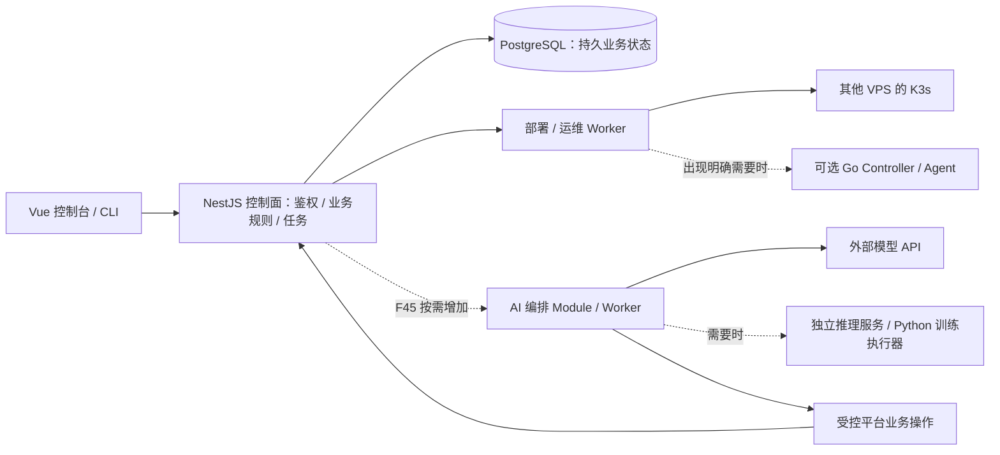

# 后端技术栈评估与 AI 扩展方案

评估日期：2026-10-26。依据：[统一 PRD](prd.md)、[技术方案](technical-plan.md)与[开发计划](development-plan.md)。状态：S1/S2 已通过本地验收，S3 已验证真实镜像发布、日志、私仓认证/轮换与 Worker 中断恢复；分项证据见 [S1](acceptance/S1.md)、[S2](acceptance/S2.md)和 [S3 记录](acceptance/S3.md)。未调用收费模型服务，Oracle 容量仍待目标机实测。

目标是判断当前后端是否会阻碍后续功能，以及如何把必要的升级和替换控制在局部。已确认长期维护 TypeScript / Node.js，AI 优先调用模型 API，涵盖部署助手、日志诊断和知识库问答。F45 的基础范围以 PRD 第 7.1 节为准；GPU 推理和训练/微调仅保留为将来的架构参考。

## 1. 当前建议

**推荐采用 TypeScript＋Node.js LTS＋NestJS 主控制面，PostgreSQL 作为持久数据基础。** 这一推荐同时符合已确认的维护语言和 API 型 AI 方向。根据当前 F01–F42 与 F45 的需求，没有发现必须换语言才能实现的功能障碍；实际资源上限仍须测试。

具体取舍：

1. **S1 已采用 NestJS＋Fastify Adapter。** 鉴权、原始请求体验签与流式通道分别验证。Fastify 是 HTTP 实现选择，不负责提升数据库、外部 Kubernetes API 或模型的速度；HTTP 探针的实际范围见后端基线记录。
2. **Prisma 可继续采用，允许必要的参数化 SQL/TypedSQL 和 SQL 迁移。** 不要求所有 PostgreSQL 功能必须能由 ORM 完整映射。数据库访问实现留在相应 Module 内，不把 ORM 类型传播到 Web/CLI 或所有业务调用方。
3. **BullMQ 负责投递与执行调度，业务状态仍在 PostgreSQL。** 部署快照、幂等、等待状态和恢复规则独立保存。未来复杂 AI 工作流可另选编排实现。
4. **AI 模型调用和工具编排使用 TypeScript。** 首批接入外部模型 API，知识库优先验证 PostgreSQL＋pgvector；若以后确需 Python 专属处理或自托管推理，再以独立执行环境接入。
5. **Go 是值得保留的控制器/执行器选项。** 若长期主业务已明确转为 CRD/operator、大量持续资源协调或轻量常驻 agent，现在选择 Go 主栈有理由；若这些只是以后可能需要，先保留可独立演进的集群执行 Module。

Vue 不要求后端一定用 TypeScript，前后端共享语言也不是性能依据。当前推荐来自两点：管理 API、数据库、远程 Kubernetes/SSH、Git/Registry 和模型调用以 I/O 为主；用户已确认熟悉且希望长期维护 TypeScript / Node.js。

2026-10-26 的[本地 S3 API 长时结果](acceptance/s3-api-load-available.json)提供了更具体的证据：100 个服务元数据、1 万条部署历史、5 个闭环并发客户端持续 600 秒，共 296,164 次请求无错误；服务端整体 P95 23 ms，草稿元数据修改 P95 41 ms，100 次持久诊断任务接收 P95 32 ms。API 进程峰值 RSS 约 392 MiB，平均 CPU 约 1.73 核。[Redis 不可用的另一轮 600 秒](acceptance/s3-api-load-unavailable.json)完成 324,593 次请求、无错误，整体 P95 21 ms；100 次任务均持久接收为 202，P95 32 ms。该故障由隔离 API 的拒绝连接地址注入，共享 Redis 保持运行。测试运行在 M1 Pro/macOS，使用独立生产 API 与临时 PostgreSQL schema；包含模拟历史，未部署 100 个真实应用，也未在该 schema 执行 Worker。两轮负载时间不同，不作 Redis 开关性能对比。结果支持继续采用当前主栈，但不能替代 Oracle 实测、完整系统资源统计或真实应用容量测试。

## 2. 真实限制在哪里

| 层次/场景 | 实际限制 | 对本项目的处理与换栈影响 |
| --- | --- | --- |
| Node.js 主事件循环 | 同一 JavaScript 主线程上的长计算会阻塞该进程；大量 JSON/YAML 处理、压缩和重日志解析会影响请求、心跳或任务续租 | API 与 Worker 分进程；控制输入大小和并发，CPU 密集任务采用 worker_threads、独立进程或外部执行器。多个进程可分别使用 CPU，不是整个平台只能用一核 |
| 持续连接与数据流 | 日志、终端、模型输出会受到慢消费者、缓冲、连接数和断线清理影响 | 有界缓冲、背压/批处理、超时和关闭传播；不为每个浏览器窗口重复建立无限制的上游订阅。语言更换不能代替这些设计 |
| Kubernetes 客户端 | JavaScript 客户端具备 Watch、Informer、Log、Exec；与 Go 的控制器配套生态不同，仍需处理错误恢复、凭证更新和版本兼容 | S2 前期验证实际接口；每集群/凭证版本隔离客户端。若主要工作变成复杂控制器，可局部使用 client-go/controller-runtime |
| Prisma | 并非每种 PostgreSQL 类型、扩展和高级查询都有完整生成类型 | pgvector 等能力可通过数据库扩展、自定义迁移、参数化 SQL/TypedSQL 使用。某类查询可换 Adapter，无须同时换 PostgreSQL 和发布逻辑 |
| BullMQ | 任务可能因 stalled、重投或连接故障再次执行；延迟任务不保证精确时刻触发 | 业务幂等和执行状态持久化；人工等待保存状态后结束当前 job，收到事件再继续。复杂长期工作流需要额外设计，不能只靠一个进程内 Promise |
| PostgreSQL/磁盘 | 慢查询、连接池耗尽、索引、日志与历史增长可能先于语言成为瓶颈 | 查询分析、有限连接池、保留策略、备份和容量监测；不逐 token 写一条数据库记录，也不把原始日志/模型权重无界堆在控制面 |
| K3s/local-path | 本地卷不能自动跨节点搬迁，单实例数据库与控制面都有部署层面的单点 | 后续通过 CSI/备份迁移/多副本等独立方案解决；选择 Go、Node 或 Python 都不会消除这些约束 |
| 大模型计算 | 显存、GPU、驱动、模型格式、缓存、批处理与训练数据决定执行能力 | Oracle 控制面负责管理和调度；模型执行在其他机器或外部模型 API。小型模型可能用 CPU 运行，但不能据此规划 2 核控制面同时承担稳定的大模型服务 |

应用的公网流量直接进入应用集群。应用每秒接收多少用户请求，不等于 NestJS 控制面要处理同等数量请求。控制面容量应按集群数、观察对象/事件量、管理并发、日志吞吐与任务速率衡量，不能只看“部署了多少个应用”。

### 2.1 当前客户端和依赖的具体风险

- S2 已在两套真实 K3s API 上完成 JavaScript 客户端 **2.0.1** 的 B04 探针：同名 Node/凭证隔离、Token 撤销与替换、Watch 重连和实际 410 后重新 list 均通过。17 组独立 TLS/协议测试补充验证限流、超时、CA/SAN 与资源回收，来源在[SDK 验收](acceptance/S2-kubernetes-sdk.md)中区分。
- 原生持续 Log helper 取消时已实测未处理的 AbortError，Exec 标准流也缺少完整背压；检查 Adapter 已拥有自己的受限 transport。S3 已实现独立的有界 HTTPS/SSE 日志路径，包含背压、断开/撤销清理、UID/快照校验与秘密脱敏，并通过真实 K3s 产品验收；S7 终端仍需完成相应产品实现，不能把 SDK 探针当成交付。此结果支持保持 TypeScript/Node 主栈，限制封装在具体 Adapter 内。
- 当前 PRD 禁止 exec 插件；生产检查每次使用独立 SDK Configuration 和自有 TLS transport，不共享全局认证缓存。固定规模之外的容量、长时间观察和云网络仍需相应阶段测试。
- S1 实际锁定 Prisma 6.19.3，已验证 Node 24 的迁移、数据库约束和连接，并显式设置连接池/超时。先前调研的 Prisma v7 使用不同的 Client/driver adapter 方案，未来升级需单独迁移与回归，不能把 v7 文档中的默认行为当成当前实现。Oracle 上的原生依赖与容量仍需要目标机验证。
- 当前 Prisma 对 pgvector 的 VECTOR 仍无完整原生映射，但有官方 SQL 扩展路径；当前文档也已有部分索引支持，不能把旧版本的缺项当成永久限制。
- Redis 7.4 采用 RSALv2/SSPLv1 双许可，8+ 增加 AGPLv3 选项；本轮查到的维护策略仍包含 7.4。个人内部队列用途不因此自动受阻。若将来对外提供托管产品，应核对具体版本、许可和使用方式；Valkey 可作兼容性验证候选，不假定无测试即可替换。
- BullMQ 的持久化、`noeviction`、日志/任务保留与重试上限需要明确配置。Redis 的可靠配置不改变跨 PostgreSQL/Kubernetes 操作仍需幂等和对账的事实。

这些事实只用于识别验证项。实施时重新锁定受支持的稳定版本，不能把上游开发分支的新功能当作已选版本的保证。

## 3. 主栈方案比较

| 方案 | 最适合的重心 | 对当前 Ozz 的适配 | 主要代价 |
| --- | --- | --- | --- |
| **TypeScript＋NestJS** | 产品管理 API、异步 I/O、业务编排、模型 API 和工具调用 | 当前推荐主线，符合已确认维护语言；前后端契约和领域逻辑容易协作，已有 PRD 的功能均有可行实现路径 | 要约束事件循环阻塞，管理包版本、流式资源和可恢复任务；云原生控制器配套不如 Go 集中 |
| **Go＋HTTP 框架＋pgx/sqlc 等数据访问** | Kubernetes Controller/Operator、持续事件协调、常驻 agent | 若这些是确定的核心投入，且愿意长期维护 Go，可现在调整 | 需重做 Nest/Prisma/BullMQ 的实现选型和计划；Go 不自动提供任务恢复、数据库迁移或 AI 能力，也不保证网络/SQL 瓶颈会改善 |
| **Python＋FastAPI** | 模型研究、数据处理、训练管线与 Python 专属生态 | 可做控制面；在现有定位下更适合作为需要时增加的 AI 执行服务 | async 不会让 CPU/GPU 计算自动并行；仍要管理进程、任务、状态、流式通道和权限 |
| **Java/Kotlin＋Spring Boot** | 已熟悉 JVM 生态、重业务服务与长期工程体系 | 功能可行；熟悉该栈时值得考虑，2 核/12 GB 不能仅凭语言名判断不够 | 构建、部署、运行资源和运维方式与当前方案不同，需要实际基线；仅因未来接入 AI 没有明显必要整体切换 |

不使用 Hello World QPS、单次 ORM 查询或语言排行榜决定本项目选型。需要比较的是同一组数据库、集群观察、流式通道和恢复任务；否则得到的倍数不能预测真实控制台体验。

## 4. AI 的三种不同扩展方向

### 4.1 调用模型 API：部署助手、日志诊断、知识库

这是已确认的优先方向，适合 TypeScript 控制面：模型请求、流式输出、工具输入校验、平台权限、检索和任务审计均可实现。

需要规划的能力：

- 模型提供方能力声明，明确是否支持流式、结构化输出、工具调用、视觉和 embedding；更换提供方要验证协议、参数和事件，不能只修改 `baseURL` 就假定等价。
- `AiRun` 的输入版本、步骤、工具调用 ID、取消、结果、用量与失败记录；这些在 F45 实施时建模，不提前污染 Project/Service 的核心数据。
- 模型只能提出结构化操作，实际动作复用已有发布/停止/域名等业务 Interface，执行项目/环境/集群范围、revision、权限和幂等校验。日志和仓库文本属于待分析数据，不能成为新的操作授权。
- 流式连接断开与任务取消分别处理；重连不重新执行已发生的工具副作用。上下文、输出、调用次数和执行时间有上限，模型或 AI 队列故障不占满普通部署任务的执行能力。
- RAG 可先评估 PostgreSQL＋pgvector，检索保留来源、版本及访问范围；embedding 模型变化需版本化并重新生成相应语料向量，即使维度相同也不能混用不同向量空间。维度变化还需调整存储与索引，完成重建和验证后切换。解析大文档、OCR、批量 embedding 等按实际依赖放 Worker 或独立 Python 执行服务。

F45 已明确分为共用基础与部署助手、日志诊断、基础知识库三个子迭代，按 PRD 第 7.1 节和开发计划的 P2.03 执行。提供方、模型、知识库容量和预算在实施该迭代前锁定，不阻塞 S1 的基础工程。

### 4.2 自托管模型推理

控制面可管理模型服务配置、镜像、端点、版本和健康；真正推理由外部 GPU 节点上的成熟推理服务执行，必要时通过 HTTP/gRPC 接入。

这需要额外验证 GPU 驱动与 device plugin、资源声明、模型/镜像架构、模型缓存盘、冷启动、并发和显存。当前 F08 的普通 CPU/内存配置尚不等于 GPU 部署功能，需单独补需求。80 GB 控制面磁盘预算不包含模型权重和缓存。

### 4.3 训练与微调

控制面提交、查询、取消任务并管理数据集/参数/产物引用；Python/PyTorch 等训练镜像在独立执行环境或 Kubernetes Job 中运行。

需要新增训练任务、checkpoint、失败恢复、模型评估、GPU 配额和必要的分布式执行设计。普通 Deployment 和现有部署状态机不能直接冒充完整训练平台；更换主 API 语言也不能省略这些产品与执行能力。

图中的 AI、GPU 和 Go 是演进位置，当前并未创建。跨进程拆分会增加部署、认证、超时和协议维护成本，应由具体需求触发。

## 5. 降低未来整体重写风险的约束

| 保持稳定的 Interface / 数据 | 可在内部调整的 Implementation | 替换时仍需处理的工作 |
| --- | --- | --- |
| Web/CLI 的版本化 REST/OpenAPI 契约 | Nest HTTP Adapter，必要时其他后端实现 | 错误、认证、流式与兼容回归；前端不依赖 Prisma/框架对象 |
| 部署快照、运行意图、幂等、权限与状态转换规则 | 调度库或某个执行器 | 规则须独立于 `BullMQ.Job`、Express/Fastify request 与模型 SDK，避免迁移时连业务行为一起改 |
| PostgreSQL 模型与相应 Module 的查询能力 | Prisma、TypedSQL 或专用查询 Adapter | 数据/迁移兼容、事务和索引验收；不能把“可替换”理解成无成本迁移 |
| 远端资源操作、观察结果与错误契约 | JavaScript Kubernetes 客户端或独立 Go 执行 Module | 版本化 HTTP/gRPC、凭证范围、超时/幂等及双版本过渡；Go 不直接依赖 BullMQ 的 Redis 内部键结构 |
| AI 运行、工具操作与检索契约 | 模型 SDK、提供方、Agent 编排框架、向量查询实现 | 能力差异、历史记录、索引与恢复行为验证；提供方私有格式留在 AI Module 内 |

对于人工审批、等待外部事件或数天后恢复的 AI 流程，先用持久状态与事件推进，不长期占用活跃 Worker。若大量分支、补偿和跨版本恢复成为核心能力，可评估 Temporal 等持久工作流方案；它需要新的编排实现和运维，不是直接替换一个队列包。已有的幂等部署操作应能继续被调用。

现阶段只为已经存在的外部依赖和确有测试替身需要的地方设置 Seam；不为每张表机械增加泛型 Repository，也不提前建立没有调用方的 AI/Go 微服务。

## 6. 提前执行的技术验证

以下归入既有阶段，S1 已执行其中的基础安全、持久化、恢复和 HTTP 分项检查；阶段报告记录最终结果及未验证项。最小技术探针只证明所测协议或依赖，不代表相关 P1/P2 产品功能已交付。

| 编号 | 验证内容 | 对应阶段与完成时点 | 决策用途 |
| --- | --- | --- | --- |
| B01 · 运行时与 HTTP | 固定 Node/Nest/驱动和基础镜像；验证 Cookie/CSRF、rawBody 验签、SSE/流式 HTTP、WebSocket 和关闭传播；需要上传时检查对应适配器实现 | S1.01/S1.04/S1.09 先做最小通路；实际 ARM64 原生依赖/迁移在目标架构环境验证，Oracle 未创建时保留该项未验证 | Fastify/Express、基础镜像或版本选择；不让 HTTP 框架对象渗入业务 |
| B02 · 数据访问 | 临时真实 PostgreSQL：任务＋Outbox 事务、唯一/外键/竞争约束、连接池超时和必要 SQL；F45 知识库子迭代补 pgvector 迁移/写入/检索/恢复 | S1.03/S1.05；向量部分在 F45 | 验证 Prisma/驱动能否正确表达数据行为；必要时局部用 SQL |
| B03 · 任务恢复 | Redis 中断/恢复、Worker 终止、重复投递和持久等待后的事件恢复；先使用诊断任务，真实发布副作用在 S3 验证 | S1.08/S1.10 建立基础，S3.03/S3.10 验证远端效果 | 确认状态与幂等不依赖单个进程；发现问题先定位持久模型和租约，再决定编排实现 |
| B04 · 集群与流式 SDK | 两套独立真实 API 的同名用户/节点、凭证替换、超时/429/410、观察恢复；对日志和 Exec 做慢消费者/断开/回收技术探针 | S2.04–S2.08 期间提前验证，进入 S3 前完成；可先用临时本地集群探针，不能替代 S2 的真实 VPS 初始化与导入验收 | 判断客户端恢复/背压封装的可维护性；必要时调整该 Adapter 或评估 Go 执行 Module |
| B05 · 代表性负载 | 沿用 100 服务元数据、1 万部署历史、5 并发管理请求、2 个有界日志窗口、10 分钟；记录 API 延迟、CPU/RSS、事件循环延迟、Buffer/连接、数据库与队列等待。AI 仅先做可控流式上游探针 | S1/S2 起建立分项基线，G-MVP 在目标控制面汇总；F45 再验证真实模型能力、限额与错误 | 按 N03 判断；模型模拟上游不能证明真实提供方兼容。Go 对照只针对已定位热点，使用相同业务负载 |

B04 的 Exec 探针不提前交付 F32 的交互终端产品；F32 的会话权限、界面、审计和完整流程仍在 S7/S9。基础日志持续性验收仍在 S3，AI 工具行为仍在 F45。

当前性能目标只是起点：PostgreSQL 可用时，既定场景下服务器侧 API P95≤1 秒；Redis 不可用也分别测量。真实架构、网络、依赖版本和样本必须记录。不能用开发机结果代替 Oracle 实测，也不能用元数据样本承诺相同数量真实应用或无限集群的容量。

## 7. 何时调整，调整多少

| 出现的证据或确定需求 | 优先调整 |
| --- | --- |
| 卡在 SQL、连接池、外部 Kubernetes/模型延迟 | 先调整查询、索引、池与访问方式；单纯换 API 语言无法消除这些等待 |
| 已限制输入/并发并处理背压，仍由 Node CPU 热点导致 N03 不达标 | 隔离或优化该计算；用同一负载比较 worker_threads、专用执行服务或 Go 实现，再决定范围 |
| 产品核心确定为 CRD/operator、持续协调和大量常驻 agent | 在规模实现前重新评估 Go 主控制面或 Go 执行层，同时重估计划 |
| 业务查询大部分需绕过 ORM，维护和迁移成本持续超过收益 | 更换数据访问 Implementation，保留 PostgreSQL 与业务规则 |
| AI 流程需要大量持久等待、分支、补偿、跨版本恢复 | 对 AI 编排引入持久工作流，保留现有平台操作 Interface；设计运行中任务的迁移路径 |
| 确认使用 Python 专属模型/解析/训练生态 | 增加 Python 执行服务或训练镜像；前端、平台鉴权和部署 API 无需因此一并迁移 |
| 控制面真实资源不足 | 根据 CPU/内存/磁盘/连接的实测瓶颈扩容或分离执行资源，不以库或语言名称推导所需规格 |

结合已确认的维护语言和 API 型 AI 方向，继续采用 Node/NestJS。后续调整由明确的新需求或验证结果触发；已锁定依赖与 HTTP 适配器，但本地分项测试不代表目标机容量已经达标。

## 8. 官方依据与证据边界

- [Node.js 事件循环](https://nodejs.org/en/learn/asynchronous-work/dont-block-the-event-loop)、[Node 24 worker_threads](https://nodejs.org/docs/latest-v24.x/api/worker_threads.html)：CPU 密集 JavaScript 与 I/O 的不同处理方式。
- [Nest Fastify 文档源码](https://github.com/nestjs/docs.nestjs.com/blob/master/content/http/performance.md)、[上传处理源码](https://github.com/nestjs/docs.nestjs.com/blob/master/content/http/file-upload.md)：HTTP provider 与平台专属适配。上游主分支不等于项目锁定版本，不引用简单路由倍数作容量承诺。
- [Kubernetes API Watch 语义](https://kubernetes.io/docs/reference/using-api/api-concepts/)、[JavaScript 客户端 2.0.1](https://github.com/kubernetes-client/javascript/tree/2.0.1)、[Informer](https://github.com/kubernetes-client/javascript/blob/2.0.1/src/cache.ts)、[Exec 流](https://github.com/kubernetes-client/javascript/blob/2.0.1/src/web-socket-handler.ts)、[controller-runtime](https://github.com/kubernetes-sigs/controller-runtime)：接口能力与需要验证的恢复/缓存/流处理。
- [Prisma 系统要求](https://www.prisma.io/docs/orm/v7/reference/system-requirements)、[v7 升级变化](https://www.prisma.io/docs/guides/upgrade-prisma-orm/v7)、[数据库扩展](https://www.prisma.io/docs/postgres/database/postgres-extensions)、[pgvector 安装](https://github.com/pgvector/pgvector#installation)：版本、驱动和扩展能力。自托管 PostgreSQL 仍需自行安装/备份对应扩展。
- [BullMQ 延迟任务](https://docs.bullmq.io/guide/jobs/delayed)、[stalled 重投](https://docs.bullmq.io/guide/workers/stalled-jobs)、[生产配置](https://docs.bullmq.io/guide/going-to-production)、[Redis 兼容实现](https://docs.bullmq.io/guide/redis-tm-compatibility/)、[Temporal 持久等待与消息](https://docs.temporal.io/develop/typescript/message-passing)：调度、重投与工作流的不同责任。
- [Redis 许可](https://redis.io/legal/licenses/)、[维护策略](https://github.com/redis/redis/blob/unstable/SECURITY.md)、[Valkey 许可](https://github.com/valkey-io/valkey/blob/unstable/COPYING)：只记录本轮读取时的情况，未来分发/托管方式改变时重新核对。
- [FastAPI 并发与并行](https://fastapi.tiangolo.com/async/)、[Kubernetes GPU 调度](https://kubernetes.io/docs/tasks/manage-gpus/scheduling-gpus/)、[Kubernetes Job](https://kubernetes.io/docs/concepts/workloads/controllers/job/)：AI 执行资源与控制面语言的不同职责。

源码审查、官方文档和架构推断不等于运行验证。S1 的 B01–B03 与分项性能结果见 [后端基线](acceptance/S1-backend-baseline.md)和 [S1 验收](acceptance/S1.md)；S2 本地 B04 见 [SDK 验收](acceptance/S2-kubernetes-sdk.md)。B05 完整业务负载、真实模型兼容及 Oracle 容量仍按对应阶段验证。
