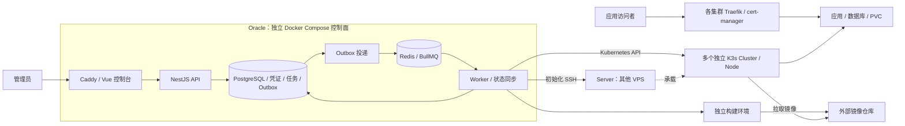
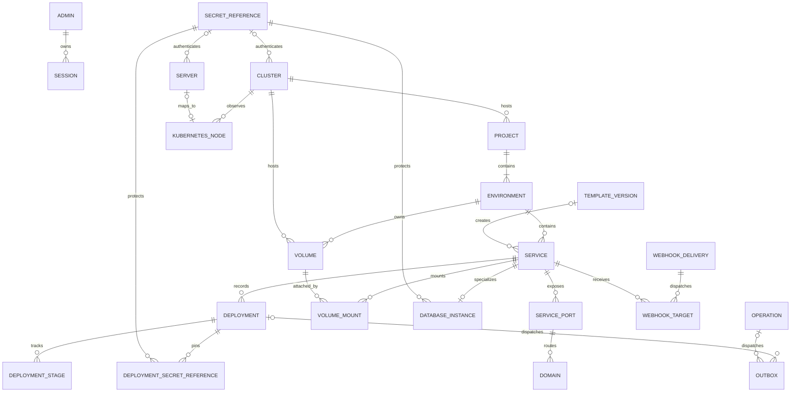

# Ozz 个人 PaaS 平台 · 完整产品需求文档

文档版本：1.5。更新日期：2026-10-26（Asia/Shanghai）。状态：完整需求基线；Stitch 设计与 S1–S4 对应本地产品验收已交付。S5 主库升级、模板、持久化、连接注入、数据保留、三类新目标恢复、真实控制台和失联恢复已通过，固定源码的 Linux ARM64 四镜像、Compose 19 项检查与归档核验已完成，见 [S5 验收](acceptance/S5.md)。S6 GitHub 与独立构建器已开始实施，尚未验收。真实云接入在 VPS 准备后执行；需求范围与退出条件不变。

本文件是产品范围、优先级和业务行为的唯一需求依据；[开发计划](development-plan.md)负责阶段、任务、依赖与验收安排，[技术方案](technical-plan.md)负责实现架构。原始输入保存在[原始 PRD](prd-original.md)，[Zeabur 对照](zeabur-gap-analysis.md)保留调研依据，不再作为另一套待选需求清单。

## 1. 产品定位与目标

Ozz 是供单一管理员使用的自托管 PaaS，以 K3s 为应用运行底座，统一管理不同服务商、地区的 VPS 和多个相互独立的集群。管理员通过中文 Web 控制台完成服务器接入、服务配置、发布、域名/证书、日志、数据库和存储管理；CLI 与自动化工具使用同一平台接口。

首要目标是建立可验证的真实部署闭环：登记服务器 → 初始化或接入 K3s → 创建项目并绑定一个集群 → 在项目环境中创建服务 → 发布镜像 → 观察真实状态和日志 → 分配域名与 HTTPS → 浏览器访问。随后完成持久化数据库和 GitHub 提交自动构建部署，达到完整 MVP。

完整个人版再加入变量引用、配置文件、多服务模板、自动构建、终端、备份自动化、历史观测、节点维护和 CLI，逐步接近 Zeabur 的核心自带服务器体验。

### 1.1 用户与范围

- 唯一角色是平台管理员；不开放注册，不建立多租户、团队角色、订阅、账单或预算停服功能。
- 默认一台 VPS 可以独立组成一个 K3s 集群，不将跨地区服务器默认拼成共享集群。
- 控制面短暂不可用时，已经运行的应用继续由 Kubernetes 管理，不因控制面断联而主动缩容或删除。
- 不自研 Kubernetes、容器运行时、Ingress 网关、证书签发服务或通用构建系统。
- 跨地域自动容灾、复杂多云调度、企业 SLA、自研数据库高可用和大规模自动扩缩容不属于当前版本目标。
- 对象存储、消息队列和其他数据库可后续通过模板扩展，不为每类应用建立独立部署引擎。

### 1.2 发布范围与优先级

| 等级 / 里程碑 | 范围 | 退出条件 |
| --- | --- | --- |
| P0 · 完整 MVP（产品 v0.1） | F01–F25；基础工程、真实多集群接入、镜像部署、HTTPS、持久化 PostgreSQL/Redis、GitHub＋Dockerfile、最小备份恢复和必要安全/可靠性 | S1–S6 完成并通过 G-MVP 联合验收 |
| P1 · 完整个人版（产品 v1.0） | F26–F42；开发体验、网络增强、数据运维、观测、节点生命周期和 CLI | P0 保持通过，S7–S8 完成并通过 S9 验收 |
| P2 · 可选扩展 | F43–F50；按实际需要选择的高级能力 | 每项先验证依赖和设计，再独立验收，不阻塞 P0/P1 发布 |

GitHub＋Dockerfile 和持久化数据库明确属于 P0，解决原始稿“标为 P1 却要求 MVP 必须完成”的冲突。P0 备份要求可运行的手工恢复闭环；平台化、定时和远端备份自动化属于 P1。P0 的 Node.js/静态站点模板采用已验证的示例镜像；用户源码的免 Dockerfile 构建属于 P1。

P0/P1 表示应用交付范围，不表示所有功能已实现。完整 Stitch UI 与交互设计覆盖各优先级页面、流程和状态；应用代码按阶段交付，实际结果见 [S1 验收](acceptance/S1.md)与 [S2 验收](acceptance/S2.md)。后续优先级与阶段关口保持不变。

## 2. 已确认约束与推荐部署

### 2.1 基础设施

| 项目 | 基线 |
| --- | --- |
| 控制面 | 新建 Oracle 实例，只运行控制面；建议先选 2 核 / 12 GB / 80 GB |
| 实例状态 | 尚未创建，Shape、操作系统、架构、主区域和实际免费权益待建机时核对 |
| 存储口径 | 用户提供总额度 200 GB、已有实例使用 50 GB；若新增 80 GB，按此口径剩余 70 GB，须检查其他保留卷 |
| 应用运行面 | 其他 VPS 上的独立 K3s 集群；不在 Oracle 控制面部署应用 PVC 或应用数据库 |
| 构建与镜像 | 独立构建执行环境和外部 OCI Registry；控制面 Worker 负责调度，不在控制面编译用户代码 |
| 系统兼容 | 自动初始化首批支持经验证的 Ubuntu 24.04 LTS；amd64/arm64 分别验收。其他系统先走已存在集群导入路径 |
| 域名 | 控制台管理域名独立；应用使用平台后缀和每集群子后缀 |

若选择 Ampere A1，则验证控制面镜像及 Node/Prisma/本地二进制依赖的 ARM64 兼容性；应用镜像按目标集群 Node 架构校验。用户提到的 4 核 / 24 GB 与本轮读取的 Oracle 公开 A1 免费口径不同，建机以账户权益及费用预估核对，不承诺某个规格必定免费。80 GB 是规划起点，不是实测容量承诺。

控制面磁盘初始预算：系统与镜像约 20–30 GB、平台数据库约 5–10 GB、任务日志约 5 GB、本机临时备份约 5 GB，尽量保持至少 20 GB 可用空间。日志按 14 天或总量 5 GB 的上限清理，Docker 日志独立轮转；长期备份离开本机。卷扩大后核对分区和文件系统，不依赖原地缩小卷回退。

### 2.2 技术栈与分工

| 层次 | 选择 |
| --- | --- |
| 工程 | TypeScript、Node.js 24 LTS、pnpm Monorepo；实施时锁定补丁版本和 lockfile |
| 控制台 | Vue 3、Vite、Vue Router、Pinia、TanStack Vue Query、shadcn-vue（Reka UI）、Tailwind CSS 4 |
| API | NestJS、OpenAPI、配置/DTO 校验、Pino 结构化日志 |
| 数据与队列 | PostgreSQL 17、Prisma、Redis 7.4、BullMQ、独立 Worker、事务 Outbox |
| 控制面入口 | Docker Compose、Caddy，同源控制台和 `/api`，独立管理 HTTPS |
| 集群接入 | K3s、官方 Kubernetes Node.js 客户端、受控 SSH 初始化 |
| 应用入口 | Traefik、Kubernetes Ingress、cert-manager |
| 数据运行 | Deployment 或单实例 StatefulSet、Service、Secret、PVC、local-path-provisioner |
| 构建 | 独立 BuildKit；P1 评估并固定成熟自动构建器，先支持 Node.js/静态网站 |
| 后续观测 | Prometheus；长期集中日志按需接入 Loki 或兼容外部日志存储，资源单独规划 |

已确认长期维护语言为 TypeScript / Node.js，AI 优先通过模型 API 实现部署助手、日志诊断和知识库问答。主控制面继续推荐 NestJS；HTTP 适配器与具体依赖通过早期验证确定。AI 三项能力归入 F45 的后续 P2 迭代，不改变 P0/P1 关口；详见第 7.1 节及[后端选型评估](backend-stack-evaluation.md)。

Server 是 SSH 管理对象，Cluster 是一套 Kubernetes API，Node 是该 API 观察到的节点；导入集群中的 Node 可以没有对应的 Server。单 VPS 场景可在 UI 中用服务器名称展示其单节点 Cluster，实际保存和调度仍使用同一个 clusterId。尚未关联 Cluster 的 Server 先进入接入流程；同一多节点 Cluster 不因多个 Server 入口而成为多个部署目标，选择入口也不表示将项目固定到某个 Node。应用流量直接进入应用集群，不经 NestJS 控制面。

## 3. 核心用户流程

| 流程 | 用户操作 | 可见结果 |
| --- | --- | --- |
| 首次启动 | 按文档初始化管理员并登录，登记部署目标，创建项目时选择一个 Cluster | 项目与默认 production 同时保存；可绑定已登记但未验证的 Cluster，未验证状态可见，发布前仍需完成真实接入 |
| 服务器接入 | 填写地址/凭证引用，核对主机指纹，执行预检，再安装或导入 K3s | 分阶段任务、真实节点状态、可定位的连接/权限/系统错误 |
| 镜像发布 | 进入项目并选择环境，核对继承的集群目标，填写镜像/端口/变量/资源/探针，创建部署任务 | 目标来自项目且实际可用；独立部署记录、进度、Pod 状态、运行日志；成功后域名可访问 |
| 发布失败排查 | 查看阶段、事件、错误和当前实际版本，修正后重试或重新部署 | 原失败记录保留，新任务单独可追踪；不假装已经自动回滚 |
| 数据库使用 | 通过 PostgreSQL/Redis 模板创建服务和卷，将连接信息注入应用 | 默认私有访问；重建 Pod 后数据保留；正式使用前完成备份恢复 |
| Git 自动部署 | 连接 GitHub、配置分支/Dockerfile/构建环境、提交代码 | 验签去重后构建、推送、按 digest 部署；失败可定位，暂停服务不被自动拉起 |
| 运维与自动化 | 查看历史指标/告警、执行容器命令、维护节点、备份或使用 CLI | 操作有状态、结果和授权范围，危险资源动作展示具体影响 |

## 4. 统一业务语义

统一归属为 `Cluster → Project → Environment → Service`。每个 Project 必须且只能绑定一个已登记的 Cluster，同一 Cluster 可以承载多个 Project；Project.clusterId 是非空外键，不对该字段建立单列唯一约束。Environment 通过 projectId 归属项目，Service 通过 environmentId 归属环境；两者不配置独立目标。创建项目会在同一事务中创建默认 production，普通编辑不能修改项目的 clusterId，也不能将已有环境改挂到另一个项目。

S1 可绑定未验证的 Cluster 登记完成项目元数据管理，不依赖 S2 已完成真实接入；没有目标登记时先登记或接入，不能创建无目标项目。实际发布必须检查该 Cluster 的连接、权限和所需能力。同一项目的 production/staging 等环境使用同一集群；需要分集群的生产/测试场景使用不同项目，按 F39 复制配置或按 F48 迁移数据。环境仍分别拥有服务、配置、卷和发布，不能把共用集群视为共用运行状态或已具备网络隔离。

### 4.1 配置与真实状态

每个服务分别保存：

1. **草稿配置**：可编辑的期望配置 revision，保存成功只表示数据已持久化。
2. **已发布快照**：最近一次确认所有目标资源完整应用到 Kubernetes 的不可变配置快照；健康检查失败不会自动将它改回旧版本。
3. **最近成功部署**：历史成功记录，用于查询和选择镜像回滚，不代替当前运行状态。
4. **实际观察**：Kubernetes 的 generation/revision、Pod、副本、镜像 imageID、错误和采集时间；滚动更新期间可能出现多个版本。
5. **期望运行状态**：running、stopped 或 deleting；配置副本数单独保存，停止时实际目标副本为零。

若一次发布仅部分应用，或者无法确定完整快照，标记“配置不一致”。允许请求停止；恢复/重启必须先完成对账或明确的新发布，不能用混合 Pod 配置拼出一个假定版本。集群失联显示 unknown/unreachable 和最后观察时间，不等同于 stopped。

### 4.2 发布状态与任务

镜像路径：`queued → deploying → waiting_healthy → succeeded`。

Git 路径：`queued → building → deploying → waiting_healthy → succeeded`。

终态为 `succeeded`、`failed`、`cancelled`；每阶段记录开始/结束时间、尝试、错误码、原因及日志索引。取消先记录请求，确认执行结束后才标记 cancelled；已经发生的集群变化照实记录，不承诺取消等于回滚。历史成功记录不因应用后来崩溃而变为失败。

API 在 PostgreSQL 同一事务中保存业务任务和 Outbox，返回 `202` 后由 Worker 执行。Redis 不可用时仍可接收已持久化的任务，明确显示排队原因。Deployment/Operation 是持久记录，BullMQ Job 只承担调度。

同一服务的发布、重启、停止、恢复和删除共用一个活动任务槽位。幂等键在请求作用域内唯一：同键同请求返回同一任务，同键不同请求返回冲突。失去租约的 Worker 不得继续变更；外部更新使用版本条件和 revision 校验，恢复任务先观察实际副作用。

服务相关 Deployment/Operation 固定记录受理时的 projectId、environmentId、clusterId 和目标 Namespace；后端沿项目归属解析目标，任务执行不读取当前页面上下文。重试、重启、恢复和回滚不能改投其他集群；管理认证仍使用该固定目标当前有效凭证。F48 的切换另须阻止旧源任务在迁移后重放，此项随 P2 迁移验收。

### 4.3 用户动作输入

| 动作 | 使用的输入 | 结果 |
| --- | --- | --- |
| 保存配置 | 编辑中的草稿 | 更新 revision，提示有未发布变更，不修改运行面 |
| 发布/重新部署 | 用户确认的草稿或指定完整配置 | 创建新 Deployment，最终快照和镜像 digest 可追溯 |
| 失败重试 | 原任务固定的配置/源 commit；已确定的镜像复用原 digest，管理认证使用当前有效凭证 | 新记录关联 retryOfId，保留原失败原因；产物缺失明确失败，尚无产物时才按原输入生成；不悄悄改为最新草稿或重新解析 latest 替换已知版本 |
| 重启 | 当前完整已发布快照 | 可追踪 Operation，不引入草稿；服务已停止时引导使用恢复 |
| 停止 | stopped 意图及当前服务身份 | 实际缩到零，保留快照、副本设置、域名和卷；失联时显示待执行 |
| 恢复 | 暂停前的完整已发布快照和配置副本数 | 重新启动并验健康，不自动切换到最近成功记录或待发布提交 |
| 镜像回滚（P1） | 历史成功 digest＋可信的当前完整已发布快照中的其他配置 | 创建新 Deployment，先展示差异；不恢复卷、数据库、迁移或草稿 |
| 删除服务 | 服务身份、资源清单和明确删除意图 | 异步清理工作负载/路由；默认保留卷，失败可重试，观察同步不重建已请求删除资源 |

对 stopped 服务，Git 推送仍需验签、去重并记录为待发布，但不自动构建、发布或恢复。恢复仅恢复原版本；用户另行选择提交并执行明确的“部署并启动”动作，才应用新版本。手动部署/回滚停止服务时，也必须明确包含启动意图。

### 4.4 凭证、依赖与数据

运行期环境变量/配置文件的 SecretReference 版本随发布快照固定。SSH、Kubernetes API、Git 和镜像仓库认证采用目标资源当前有效凭证，并审计所用版本；镜像回滚不会恢复过期的管理凭证。

服务输出引用绑定稳定 serviceId 和输出键，仅解析已就绪的同环境、同集群输出。提供方变化后提示消费者待发布，不自动热更新或重启。组合模板先发布依赖提供方，再解析消费者配置并创建其部署任务。

数据库初始化密码与已存在的数据内容分别管理。已有 PVC 的 PostgreSQL/Redis 不允许通过普通保存、发布、失败重试或镜像回滚更换数据库密码或主版本；这些入口共用同一保护校验。修改 Secret/初始化变量不代表数据库内部密码已轮换。数据库密码轮换、主版本升级只能通过 F48 的独立维护/迁移流程执行。

本地卷记录实际 PV 节点约束；local-path 申请容量不是硬配额。节点失联不代表数据已迁移，不能强制删 Pod 后默认另起写入实例。删除服务保留卷；销毁卷是独立动作，不通过删除 Namespace 间接销毁数据。

## 5. P0 功能需求：完整 MVP

以下编号长期稳定。需求中的具体测试与任务对应关系由开发计划维护。

### 5.1 身份、项目与基础设施

| ID | 功能与业务规则 | 验收条件 |
| --- | --- | --- |
| F01 | 单管理员安全初始化、登录、登出、会话过期/撤销；密码哈希，HttpOnly 会话 Cookie、生产 Secure、CSRF/Origin 校验与登录限速 | 未登录访问管理 API 返回 401；失效/撤销会话不可继续操作；不提供公开注册 |
| F02 | SSH、集群、Git、Registry、数据库等凭证加密保存，仅普通响应输出引用/脱敏元数据；支持凭证版本、有效期、替换和受引用删除保护 | 原始数据库字段、普通 API 和平台日志中不出现测试凭证明文；重启后可解密；缺少主密钥时明确失败，不能自动生成新密钥冒充恢复 |
| F03 | 项目创建、列表、详情、修改、删除；稳定 ID/slug，描述和时间；创建时必选一个已登记 Cluster，列表/详情显示目标和连接状态，普通编辑不可更换目标 | 创建项目与 production 同事务；不存在的目标被拒，未验证登记可保存但不能冒充可发布；重名返回明确错误；含服务/保留卷的项目不能直接删除，删除空项目不删除其 Cluster/Server |
| F04 | 项目下 production/staging 等基础环境模型；所有环境继承项目 Cluster，不接受环境级目标覆盖，projectId 创建后不可普通 PATCH；服务/卷/域名归属明确，默认 production 的 slug 固定且不能单独删除 | 不存在或错误项目的环境关联被拒；跨项目复制/迁移创建目标环境，不原地重挂已有环境；不同环境允许同名服务；环境切换不改变项目集群；空项目删除可一并清理空环境；不将命名空间视为严格网络隔离 |
| F05 | Server 登记的创建、查询、编辑和移除；保存名称、地址、地区/标签、SSH 用户/端口/凭证引用；校验主机指纹，检查连通性、OS/架构、CPU/内存/磁盘和所需端口 | CRUD 可通过 UI/API 完成；关联资源存在时拒绝直接删除，移除登记不卸载远端软件；未预检时显示未验证；网络/权限/指纹错误分开提示；预检只读且有超时/日志 |
| F06 | 初始化固定版本 K3s，或导入已有集群；校验远程 API 地址、CA/SAN、权限和凭证有效期；检查 Traefik、存储与指标能力 | 已有安装不被自动覆盖；拒绝危险 kubeconfig 的 exec/外部文件/跳过 TLS 等配置；至少一次真实安装与一次已有集群接入验收；API 地址/凭证可更新，但须核对仍为同一集群，不能将已绑定项目重定向到另一个集群 |
| F07 | Cluster 登记可创建、查询、编辑和受限移除；与 Node 独立保存并按 API 同步；Node 用 clusterId＋UID 标识，可不关联 Server；显示 Ready、关联项目、工作负载和观察时间 | 至少两个独立集群分别观察/操作，同名节点不串用；有关联项目（即使为空）/服务/卷/任务时不能直接移除；服务器与集群入口不重复登记同一调度目标；删除登记不卸载集群；单个集群故障不阻断另一个，断联显示 unknown/unreachable |

新建 K3s 集群启用并验证 Secret 静态加密；导入已有集群记录已启用、未启用或未知，不能在接入时静默重启/更改其安全配置。权限从引导安装身份收敛到所需 RBAC，并保留凭证到期更新路径。

### 5.2 服务与发布

| ID | 功能与业务规则 | 验收条件 |
| --- | --- | --- |
| F08 | 服务属于项目下的一个环境，部署目标从项目继承，创建/编辑不接受独立 clusterId；支持 Web、无公网入口的后台进程及数据库类型；配置镜像、命令参数数组、具名端口、requests/limits、副本和探针；保存与发布分开 | 表单和 API 校验一致；伪造目标或错误项目/环境关联被拒；默认单副本；端口用途/暴露策略明确；已有远端资源的服务不能普通 PATCH 更换环境 |
| F09 | 实现 4.2 节状态机、独立发布记录、Operation、Outbox、服务级串行、重试与取消；记录配置快照、阶段时间、错误和日志 | 重复投递不产生重复资源；Redis 故障可保存请求，恢复后补发；Worker 重启可恢复或明确失败；cancelled 不早于确认执行结束 |
| F10 | 公共/私有 OCI 镜像部署，解析不可变 digest；校验目标节点平台；生成 Deployment 与 Kubernetes Service，按需注入 imagePullSecret | 一个公共和一个受限镜像真实运行；不支持架构/拉取失败可定位；记录输入引用、解析 digest 与实际 imageID；不以 latest 冒充固定版本 |
| F11 | 配置 HTTP/TCP readiness/startup 探测、路径/端口、启动宽限、超时和失败阈值；以目标 generation、revision、Pod 和副本健康判定 | 错误探针使新部署失败并保留诊断；旧 Pod 健康不能令新版本成功；无状态滚动更新与挂卷中断更新分别验收 |
| F12 | 重启、停止、恢复、重新部署及异步删除，遵守 4.3 节语义；保留用户的 stopped/deleting 意图 | 停止后同步器不重新拉起；恢复不发布草稿；部分应用状态不能直接恢复；删除失败有可重试任务，保留卷可单独管理 |
| F13 | 基础环境变量的增删改、批量 .env 文本录入、敏感标记、重复键/格式检查；变量属于服务环境和配置 revision | 发布后容器读到正确变量；修改后提示待发布，现有容器不被静默改变；敏感值按 F02 管理；不提交真实 .env 到代码仓库 |

### 5.3 网络、日志与状态

| ID | 功能与业务规则 | 验收条件 |
| --- | --- | --- |
| F14 | 持久化默认域名后缀和每集群子后缀；分配全局唯一域名；绑定具名 HTTP 端口；Ingress/Traefik 路由、cert-manager、HTTP→HTTPS | DNS、路由、证书三个状态分别展示；真实域名 HTTPS 可访问；DNS 错误、申请/续期失败和到期可定位；改服务显示名不静默换域名 |
| F15 | 提供同集群 Service/DNS 和私有 TCP；后台/数据库服务默认无公网暴露；自动连接注入只允许同环境、同集群 | 应用可通过私有地址连接数据库；公网无法直接连接默认数据库端口；跨集群引用被拒或要求明确外部端点；不声称 ClusterIP 提供跨环境访问隔离 |
| F16 | 查看部署过程、构建和 Pod stdout/stderr；按服务/部署定位，选择 Pod/容器/previous，支持有限分页或持续刷新 | 镜像发布的构建日志显示不适用；日志有字节/条数/时间上限；Pod 删除或轮转造成历史不可用时说明原因，不伪造连续历史 |
| F17 | 节点与服务/Pod CPU、内存、requests/limits、重启、OOM 和状态；记录来源与采集时间，展示预检磁盘及实际可获得的节点存储信息 | Metrics API 缺失显示未知；不把容量当使用率；单次查询按集群批量处理；服务指标可与实际 Pod 对照 |

默认域名示例：`web-a7f3.sg.apps.example.com`。DNS 将集群子后缀解析到对应入口，Ingress 负责路由，cert-manager 负责证书；通配符 DNS 不等于通配符证书。首版 HTTP-01 为单个主机名签发，先以 ACME staging 验证，生产签发有可定位结果。

### 5.4 数据、模板与 Git

| ID | 功能与业务规则 | 验收条件 |
| --- | --- | --- |
| F18 | 卷创建、查询、挂载/卸载与独立销毁；目标继承所属环境的项目，记录 PVC 实际集群位置；显示 PVC/PV、StorageClass、容量申请、实际节点约束、回收策略和备份状态 | Pod 重建后持久数据保留；绑定前节点可未知；卷与服务须同环境同集群，实际位置不能独立编辑；销毁前同时检查期望配置及实际 Pod 挂载；拒绝隐式跨节点迁移 |
| F19 | PostgreSQL 与 Redis 单实例 StatefulSet 模板；持久化卷、私有 Service、非敏感连接信息与凭证引用；支持应用选择数据库进行有限的连接注入 | PostgreSQL 插入数据、Redis 写入键后分别重建 Pod 并验证；Redis 明确开启 AOF 及持久化策略；密码不出现在普通详情；初始化后密码/主版本的保护覆盖保存、发布、重试及回滚 |
| F20 | 内置 Docker、Node.js 示例、静态网站、PostgreSQL、Redis 基础模板；选择项目/环境并继承项目目标，参数、资源和架构校验，模板生成统一服务配置 | 五类模板均有真实可运行验收；模板不能为服务覆盖项目集群，使用统一部署记录/引擎；示例镜像版本固定，模板中没有真实密码 |
| F21 | GitHub 授权、仓库/分支、固定 commit、Dockerfile 路径/上下文；原始请求体验签、事件去重、服务分别投递；独立构建、推送 Registry、按 digest 发布 | 实际 push→构建→推送→部署→访问闭环成功；伪造/重复事件不重复部署；多服务目标不相互吞掉；构建失败留日志；stopped 服务仅记录待发布提交 |
| F22 | 平台自身数据库/主密钥及应用数据库/卷的手工备份恢复操作和记录；应用恢复默认在明确的目标项目/环境中创建新数据库服务/新卷，集群由目标项目继承，至少一份备份离开原数据机 | 正式保存数据前完成 PostgreSQL/Redis 恢复验证；控制面备份恢复后可解密凭证并先只读对账；单项数据恢复不自动切换 DNS 或迁移整个项目；记录实测恢复时间与可恢复的数据时间点，不只检查容器启动 |

普通应用挂载可写本地卷时，首版限制一个写入服务和单副本，采用 Recreate，平台发布流程等待旧 Pod 终止。数据库使用单实例 StatefulSet。ReadWriteOnce 不是所有情况下的写入互斥保证；节点失联时不自动强制删 Pod 并在其他节点启动写入副本。

构建期秘密通过独立执行环境的临时凭证/secret mount 注入，不能烘焙进镜像层、构建参数历史或普通日志。构建不挂载控制面 Docker socket，也不获得控制面数据库或集群管理凭证。Registry 的存储与保留策略由平台配置的外部资源承担。

### 5.5 平台契约与实际状态

| ID | 功能与业务规则 | 验收条件 |
| --- | --- | --- |
| F23 | REST API、OpenAPI 客户端、统一配置校验、错误、分页、健康检查和版本契约；Web/CLI 不直接使用 Kubernetes 管理凭证 | API/前端契约可一同校验；缺配置明确失败；异步失败通过任务记录返回，健康接口不泄露连接串 |
| F24 | 中文控制台、统一设计系统，以项目列表/创建/详情组织服务，环境与继承集群上下文明确；表单与状态反馈遵守第 8 章 UX01–UX08，风险动作展示具体资源和后果 | 可在浏览器完成 P0 闭环；全局服务入口可回到所属项目/环境，创建服务不绕过项目选择目标；主题、键盘、中文输入、列表/日志稳定性有实际验证；不存在以假在线、假指标或成功 toast 替代真实结果的页面 |
| F25 | 平台资源具有稳定名称、所属标签、配置 revision 和操作来源；周期观察、任务补偿、漂移提示及删除收敛 | 仅处理平台拥有的资源；普通同步不擅自覆盖外部修改；从旧数据库备份恢复时先暂停写入/投递，不能删除未知受管资源或降级更新的工作负载 |

## 6. P1 功能需求：完整个人版

| ID | 功能与业务规则 | 验收条件 |
| --- | --- | --- |
| F26 | 通用变量引用与服务输出，绑定稳定服务 ID/输出键；区分构建期/运行期和敏感类型；变化后提示依赖方待发布 | 缺失/循环引用被拒；同环境同集群依赖解析正确；秘密属性保留；不自动热更新消费者；删除提供方须检查引用 |
| F27 | 配置文件的内容/秘密引用、容器绝对路径和权限；使用 ConfigMap/Secret，进入发布快照 | 冲突路径/非法挂载被拒；更新后明确通过发布生效；文件内容跨重建可重现；不编辑任意宿主机路径 |
| F28 | 多服务模板、模板版本和自定义模板仓库；在同一项目/环境内实例化并继承一个集群目标；资源预览、依赖顺序、版本固定及部分失败处理 | 应用＋数据库组合从参数到连接注入完成；各组件不能分别选择集群；依赖就绪后创建消费者任务；重复执行不重复创建；仓库更新不静默修改已部署服务 |
| F29 | Monorepo 根目录/构建上下文/Dockerfile 路径、watch paths、共享依赖触发与自定义构建/启动配置 | 仅无关目录变化不构建；共享目录变化触发相应服务；实际构建使用已选 commit 与正确上下文；路径不能越出 checkout |
| F30 | 无 Dockerfile 的 Node.js/静态站点自动构建，使用固定成熟构建器；显示识别结果与构建计划，允许 Dockerfile 覆盖 | 至少一种 Node.js Web 应用与静态站点成功；不支持项目明确说明并允许 Dockerfile；不承诺全语言自动识别；仍使用同一发布引擎 |
| F31 | 历史成功镜像回滚，遵守 4.3 节输入与配置规则，预览差异 | 新 Deployment 使用历史 digest 和当前可信已发布配置；历史失败记录保留；不恢复草稿、卷和数据库数据；镜像不可获得时明确失败 |
| F32 | 容器一次性命令与交互终端，选择服务/Pod/container；鉴权、超时、输出/会话上限、断开处理和脱敏审计 | 一次性命令显示 stdout/stderr/退出码；交互终端可输入/调整尺寸/结束会话；无权限、Pod 消失或断联有清楚结果；不暴露主机 SSH 私钥 |
| F33 | 自定义/多个域名、解绑和排查；Cloudflare DNS API 可选接入，按 Zone/凭证引用管理平台创建的记录 | 自定义域名真实 HTTPS；DNS 与证书状态可诊断；重复绑定拒绝；解绑不删除用户无关 DNS 记录；Token 不泄露 |
| F34 | 显式配置公网 TCP 服务端点/端口，默认关闭；记录入口地址、端口分配与网络前置条件 | 一个指定 TCP 服务可外部访问且删除可释放平台入口；不能用普通 HTTP Ingress 冒充 TCP 路由；数据库保持默认私有，公开须明确操作 |
| F35 | Web 控制台手动/定时备份、下载、远端对象存储和恢复；数据库一致性 dump 与普通卷归档分别处理，容量/保留/失败可见 | 手动及计划任务均可追踪；恢复到目标项目/环境下的新服务/新卷，继承其集群并校验后明确切换；默认每日 03:00 Asia/Shanghai、保留 7 份成功备份，可配置且受存储配额约束；过期/失败可通知 |
| F36 | 节点、服务和数据库资源的历史趋势，接入 Prometheus；必要时采用受控 exporter 补网络/磁盘等指标 | 历史视图使用真实时间序列，展示采样与保留范围；指标缺口可见；采集组件有资源上限、鉴权/网络保护，存储独立规划 |
| F37 | 日志搜索、过滤、下载和按需集中保留；长期需求采用 Loki/兼容外部存储，明确时间与容量范围 | 搜索和下载结果对应服务/部署；原生临时日志与集中历史分开；重建 Pod 后集中保存记录仍可查；超限有提示，不将全部日志无界写入控制面 PostgreSQL |
| F38 | 节点异常、CPU/内存阈值、部署/证书/备份失败等告警；站内事件＋通用 HTTP Webhook 通知，支持持续时间、冷却、恢复与失败重试 | 对受控异常产生告警、发送通知并记录结果；重复事件合并，恢复通知正确；目标不可达有重试/最终失败；签名/Token 按凭证管理 |
| F39 | 项目配置导出/复制及版本化声明配置；复制到其他集群时创建绑定该目标的新项目，导入已有项目时继承其集群；明确 UI、导入文件、系统注入值的优先级；默认导出仅非敏感配置/凭证占位 | 导出再导入可重建配置，schema 与目标能力可校验；新域名/卷/ID 重新分配，内部依赖重映射，无法映射时阻止发布；不复制数据、运行状态或域名所有权，秘密不写入导出文件；声明文件仅作为显式导入的版本化输入，不为服务覆盖项目目标，也不后台覆盖 UI |
| F40 | 同项目多环境配置差异查看和独立修改；支持选定非敏感配置复制，所有环境继承同一 Cluster；严格网络隔离按 CNI/NetworkPolicy 实现 | production/staging 的变量、域名、卷和发布互不误用；复制的服务引用按目标环境重新绑定，不误连源生产数据库；需要独立集群时使用不同项目；实际网络测试证明隔离规则生效，DNS/Ingress/必要依赖仍可用；未支持策略的集群不显示已隔离 |
| F41 | 将 VPS 加入已有集群、cordon/drain/uncordon、移除和重新加入；预览工作负载、PDB、DaemonSet 和本地卷影响 | 在测试集群验证加入/排空/恢复；节点维护不改变项目绑定的 Cluster；PDB 或本地卷阻止操作时说明原因；不自动搬移本地数据、不默认 force；任务有超时、结果和失败后处置 |
| F42 | 平台 CLI：配置地址/登录、项目/环境/服务/集群、创建发布、状态、日志、重启；支持非交互与 JSON/退出码；可撤销 API Token | CLI 与 Web 操作同一 API；服务目标由项目/环境推导，集群参数不能覆盖归属；显式目标上下文防止误环境；撤销/过期 Token 被拒，服务端只保存哈希；不要求 Kubernetes 管理凭证 |

F35 的自动备份目标是成功备份间隔不超过 24 小时；存储不可用或失败时如实显示可恢复时间点及告警，不声称仍满足 RPO。F36/F37 的观测组件和长期数据需要单独容量规划，默认关闭尚未配置的外部集成。

F39 的复制可以在同一或不同 Cluster 中创建新项目，目标只在项目层选择；导出文件中的源集群信息只作参考，不能覆盖导入目标。F40 的环境复制只处理选定配置，新建的服务、卷和域名拥有独立身份；不复制源环境的 Namespace、实际 PVC、数据或发布结果。依赖引用必须按目标环境重映射，缺失时提示待配置并阻止相应发布。

## 7. P2 可选能力

| ID | 能力与边界 | 前置依赖与验收方向 |
| --- | --- | --- |
| F43 | 服务文件上传/下载/文本编辑，区分容器临时文件、PVC 和声明式配置 | 依赖 F18/F27/F32；路径/大小/权限有约束，重建后的持久性符合所在存储语义 |
| F44 | 主机 Web SSH，仅限已登记服务器的明确维护场景 | 依赖 F02/F05/操作审计；后端代理会话，指纹有效，浏览器不取得私钥，断开可终止 |
| F45 | 调用模型 API 的部署助手、日志诊断和知识库问答，按 7.1 节分步交付；复用平台权限、任务与审计 | 部署先审阅计划再执行受控操作；诊断关联日志来源/时间；知识回答引用文档/版本，无足够依据时明确说明；流式取消、用量/超时上限和工具幂等有效，秘密不外泄 |
| F46 | PR 预览环境继承项目 Cluster，明确创建条件、资源配额、秘密隔离与回收；需要独立集群时创建独立项目 | 依赖 F21/F28/F40；预览环境不单独覆盖目标；未信任 PR 不接收生产秘密，TTL/合并关闭后按数据保留策略清理 |
| F47 | CLI/接口上传本地源码或构建包 | 依赖 F21/F42；上传大小/校验和/解压路径/保留期限受控，不能包含无意上传的凭证，构建仍外置 |
| F48 | 跨集群项目及数据迁移默认在目标 Cluster 创建新 Project，保留源/目标及资源映射；数据库密码轮换/主版本升级仍是独立维护流程 | 依赖 F22/F35/F39；完成备份恢复、验证、停写及 DNS/流量切换，明确回退和源资源保留；单个服务迁移也进入目标项目，不能普通 PATCH 更换归属或在切换后重放旧源任务；不承诺本地卷自动迁移、零停机或数据库降级 |
| F49 | 高级 Gateway 路由/IP 访问规则 | 依赖 F14/F33；复用 Traefik，中间件变更可预览、验证与撤回，避免锁死管理入口 |
| F50 | 受限的无状态 HPA | 依赖 F11/F36；只允许声明无状态的服务，设置最小/最大副本和资源配额，有状态库/本地卷不自动扩副本；复杂跨地域容灾仍不在范围 |

P2 是需求目录和后续迭代入口，不代表这些能力均已在 Zeabur 全部服务器/套餐中核实，也不自动计入完整个人版工期。

### 7.1 F45：已确认的 AI 方向

AI 采用 TypeScript 编排并调用外部模型 API；首个模型提供方、模型与调用预算在该迭代开始前确定，普通管理与发布不依赖模型服务可用。默认先交付部署助手，再加入日志诊断与基础知识库；这项方向确认不表示开始编码。

| 子迭代 | 初始范围与验收 |
| --- | --- |
| 共用基础与部署助手 | 提供方 Adapter、能力声明、凭证引用、流式结果及 AiRun/步骤/工具调用记录；自然语言生成目标明确的部署计划，用户执行后仍走既有业务校验。真实提供方至少一条成功路径；超时/限流/取消和重复事件可恢复，不能重复产生部署副作用 |
| 日志诊断 | 只分析管理员选定项目/环境/服务及时间范围内的有界日志、事件和部署状态；发送前按规则裁剪/脱敏。结论引用日志片段/事件与采集时间，区分观察事实和推测，数据不足或过期时明确说明；建议默认不直接触发写操作 |
| 基础知识库问答 | 管理员显式导入 Markdown/TXT 文档，限制单文件大小与总量，记录来源、版本及索引状态；回答关联检索到的文档片段，无足够依据时说明。更新/删除后新查询不能继续使用旧版本；embedding 模型变化重新生成相应语料向量，维度变化还需调整存储/索引，完成后切换 |

运行记录包含实际提供方/模型、输入来源、配置版本、步骤、错误与可获得的用量；配置上下文大小、输出长度、调用次数、并发和任务超时上限。未知用量显示未知；向提供方发送的数据不包含平台凭证。模型/日志/文档中的指令不能取得额外工具权限，重连和重试不得重复执行已发生的操作。

关闭对话流、取消 AiRun 与取消部署任务分别处理，结果以实际 Deployment/Operation 状态为准；建议可丢弃，已执行动作遵守既有回退和数据保留语义。知识索引记录文档 hash、分块策略、embedding 提供方/模型/维度和索引版本，支持定位更新、删除及重建的影响。

知识检索先验证 PostgreSQL＋pgvector 的可行性，扩展与索引在该子迭代部署，普通业务继续使用 Prisma，必要查询使用参数化 SQL。自托管模型、训练/微调、OCR、复杂文档解析和自动抓取不属于这次确认的基础范围。

## 8. 控制台信息架构与交互

体验目标是让管理员通过项目组织服务，在切换环境、发布和排障时能快速辨认继承目标、理解真实状态并持续操作。本轮已授权在 Stitch 完成全产品 UI 与交互设计，覆盖项目优先的导航、各功能页面、关键路径及加载/空/失败/确认等状态；P2 页面须标明规划范围。应用实现仍采用 shadcn-vue＋Tailwind CSS，组件源码由项目维护；设计原型不代表组件、接口或交互验收已经实现。

### 8.1 信息架构

| 页面 | 必须解决的问题 |
| --- | --- |
| 概览 | 项目与集群/服务健康、进行中任务、需要处理的失败；数据来源和更新时间明确 |
| 项目列表 / 创建项目 | 按名称和目标查找项目，显示绑定 Cluster、服务数量和状态来源；创建时选择一个已登记目标并创建 production，无目标时提供登记/接入入口 |
| 项目详情 / 环境 | 项目头部显示固定目标，切换 production/staging 等环境，管理环境内服务、已知依赖与配置；创建服务继承当前项目/环境，避免同名服务操作串环境 |
| 全局服务列表 / 服务详情 | 全局列表聚合查找并进入所属项目/环境；详情提供概览、配置、发布、日志、域名、资源/存储，P1 加文件配置、终端与历史指标；全局创建先选择项目/环境 |
| 服务器 / 集群 | 登记、预检、接入、节点/工作负载、关联项目、凭证状态和维护任务；单节点服务器入口解析到其 Cluster，多节点服务器展示“所属集群中的项目”，不暗示项目固定运行在该 Node |
| 部署 / 操作 | 阶段时间线、镜像/commit、配置 revision、错误/日志、重试与取消；区分历史结果和当前健康 |
| 模板 | 选择项目/环境并展示继承目标；参数、所需资源、变量/卷/域名预览及部署结果；需要新项目时先完成项目创建 |
| 数据 / 备份 | 数据库/卷所属项目、环境和实际位置，备份状态，恢复到目标项目/环境的新服务/卷及风险提示 |
| 设置 | 管理域名、默认应用后缀、凭证引用、外部 Registry/构建/存储/通知、保留策略和 API Token |

公共交互规范：提交期间显示进度并阻止无意重复；异步成功提示是“任务已创建”，不是“应用已部署”；错误同时提供可读原因、错误码和 requestId。指标/列表无数据、过期、无权限和断联要区分。危险删除展示具体影响、数据保留策略并要求明确确认资源；普通可撤销编辑不增加多余确认。

### 8.2 视觉与组件基线

- 使用场景是管理员在日间办公和夜间排障时长时间查看列表、配置与日志；默认跟随系统明暗主题，同时提供显式选择并记住偏好，首屏避免主题闪烁。
- 视觉采用安静、精确的工作台方向：低干扰中性色、一个主要交互强调色，成功/失败/告警/未知使用独立语义色。背景、文字、边框、焦点、圆角、间距和密度通过统一 tokens 管理，明暗主题分别验证对比度。
- 中文正文优先使用系统中文字体与可靠回退；标题通过字号和字重建立层级，commit、镜像 digest、IP 和日志使用等宽字体，数字采用等宽数字。长值可查看和完整复制，不以缩写值执行操作。
- 桌面采用全局导航和以项目为单位的工作区；项目页面持续显示环境与继承目标，全局基础设施页显示其自身范围。复杂配置使用完整页面，查看任务可保留列表上下文。窄屏保留名称、状态和主要操作，宽表格、日志在自己的区域内滚动。
- 服务详情以“草稿、已发布、实际运行”三组紧邻信息作为核心识别方式，显示各自 revision、状态和观察时间；差异、部分应用、未知与失败有明确入口，遵守第 4 章语义。
- 应用实施时统一封装 Button、Field、Dialog、Sheet、Table 等基础组件；StatusBadge、ResourceTable、TaskTimeline、ConfigEditor、LogViewer 等业务组合复用相同交互。每个实施阶段只建立当期实际用到的组件和页面，本轮 Stitch 设计覆盖完整产品范围。

具体颜色、字号、布局和交互参数在本轮 Stitch 原型中统一设计并记录，S1 及后续应用实施再通过真实浏览器验证。原型使用明确的设计预览标记，展示的状态和数据不能冒充真实执行；真实应用中尚未交付的能力不以可点击但无效的功能入口出现。

### 8.3 体验验收标准

以下是 F24、N03、N08 的细化标准，随功能交付逐步验收；Stitch 页面与交互原型用于审阅设计覆盖，不能代替实际应用验收。P1 的日志搜索/下载、编辑器和终端不因此提前纳入 P0。

| 标准 | 必须满足的行为 | 首次落实 |
| --- | --- | --- |
| UX01 · 视觉一致 | 明暗主题及系统偏好可用；组件尺寸、排版、语义颜色、加载/禁用/焦点状态一致；主题切换不重置表单和任务 | S1，后续页面复验 |
| UX02 · 上下文与导航 | 项目内页面持续显示项目、环境及继承集群；全局服务器/集群页显示自身范围，不附加无关的 production。前进/后退恢复页签和非敏感筛选。Cmd/Ctrl+K 打开命令面板，搜索范围明确，仅导航到已有资源或可用动作；变更动作仍走正常表单/校验，不能直接绕过确认 | S1 基础导航，S3 加服务 |
| UX03 · 可信且稳定的反馈 | 区分首次加载、后台刷新、空、错误、过期和失联；刷新保留现有内容、焦点与滚动。异步操作显示排队/执行状态并提供持久任务入口；切换上下文后的迟到响应不能覆盖当前页面，失败不能先显示部署成功 | S1 诊断任务，S3 发布 |
| UX04 · 可靠编辑 | 基础/高级配置渐进展开，字段错误关联到输入并保留内容；区分未保存与已保存未发布。中文输入法组词期间 Enter 不提交、Esc 不误关闭，编辑器/终端快捷键不被全局截获；只在可能丢失编辑时提示离开。秘密草稿不持久化到浏览器存储 | S1 表单，S3/S7 配置 |
| UX05 · 高效列表 | 名称、状态、集群、版本有稳定层级；筛选/排序/分页范围明确，不以当前页结果冒充全量结果。后台刷新不重排用户正在操作的行；保留选择和筛选，长名称/域名/错误可完整查看复制 | S1 基础列表，S3 服务 |
| UX06 · 连续排障 | 日志在底部时跟随，上滚后保持位置并显示新增数量和回到底部入口；可暂停跟随、切换长行换行，明确 Pod/容器/部署来源与截断。缓冲与渲染有界，复制不夹入装饰字符；采集频率仍服从后端限额 | S3 基础日志，S7/S8 增强 |
| UX07 · 键盘、辅助技术与窄屏 | 核心流程可仅用键盘完成；焦点可见且弹层关闭后正确恢复，图标按钮有名称、状态不只靠颜色。按 WCAG 2.2 AA 的适用项检查，含手工键盘/读屏抽检；在 1440、1024、390 CSS px 和 200% 缩放验证，页面不整体横向溢出 | S1 起，每阶段复验 |
| UX08 · 响应与动效 | 本地交互及时反馈，网络等待明确显示；重模块按需加载，持续日志不阻塞输入。常规过渡约 120–200ms，以 opacity/transform 表达状态，尊重 prefers-reduced-motion；动画不延迟操作或伪造部署进度 | S1 基线，G-MVP/S9 联合验收 |

浏览器性能与服务器 API 性能分别记录。使用生产构建，固定并记录测试机、浏览器版本、视口及网络条件，在第 11.1 节的数据规模下执行导航、筛选、编辑和任务查看；本地点击/按键到可见反馈的初始目标为 100ms 内，实际交互会话的 INP 目标不超过 200ms、CLS 不超过 0.1。记录冷/热缓存差异，不能以没有交互的评分代替 INP 验证，也不能把远端构建时间计作页面无响应。

S3 起另用单窗口最多 1 万行或 5 MiB（先到者为准）的日志缓冲做持续追加测试，两个窗口运行 10 分钟，验证滚动、中文输入与内存回收；截断可见且查询范围明确。以上是待测目标，S1 建立基线，G-MVP/S9 记录实际结果。

## 9. 数据模型与一致性约束

### 9.1 核心逻辑 ER

### 9.2 持久数据职责

| 实体 / 组 | 关键数据 |
| --- | --- |
| Admin / Session / ApiToken | 管理员、密码哈希、会话/Token 哈希、到期与撤销；ApiToken 属 P1 |
| Project / Environment | Project 的稳定身份、slug、唯一目标 clusterId（非空外键，同一 Cluster 可被多个项目引用）；Environment 的 projectId、slug 和默认环境；Service 的项目和目标经 Environment→Project 推导 |
| Server / Cluster / KubernetesNode | 主机与集群身份、凭证引用、Node UID、架构/容量、连接和观察状态 |
| Service / ServicePort | environmentId、类型、草稿 revision、完整已发布快照引用、运行意图、配置副本、具名端口及观察结果；projectId/clusterId 为只读推导上下文，不接受独立配置 |
| Deployment / DeploymentStage | 输入来源、commit/镜像/digest、不可变快照及受理时的 projectId/environmentId/clusterId/Namespace、阶段/状态、retryOfId、时间、错误和日志索引 |
| Operation / Outbox | 非发布操作、固定目标、状态和副作用、租约/尝试；服务操作记录受理时的项目/环境/集群/Namespace，基础设施操作记录其明确目标；事务内待投递事件，仅归属一个 Deployment 或 Operation |
| Domain / PlatformSettings | 域名与目标端口、默认后缀、DNS/路由/证书各自状态、期望入口、检查时间 |
| Volume / VolumeMount / DatabaseInstance | environmentId、由项目目标固定的实际 clusterId/Namespace、PVC/PV、存储类型、节点位置、挂载、回收/备份状态；数据库类型、非敏感连接配置、凭证引用 |
| SecretReference / DeploymentSecretReference | 认证加密密文、keyVersion、nonce/tag、类型/到期；发布运行期秘密的版本引用及外键保留 |
| Template / TemplateVersion | 内置/仓库来源、schema、固定版本、参数/资源；组合模板增加实例化与资源结果记录 |
| WebhookDelivery / WebhookTarget | provider＋外部 deliveryId 去重；内部 webhookDeliveryId＋serviceId 去重；验签/处理/待发布状态 |
| P1 扩展 | VariableBinding、ConfigFileVersion、Backup/Schedule、Alert/Delivery、TerminalSession、环境差异和节点维护结果，按对应任务迁移 |

必须落地的约束：项目/集群 slug 唯一；Project.clusterId 为非空外键且普通 PATCH 不可修改；Environment.projectId 创建后不可普通 PATCH，跨项目创建目标环境而不重挂原环境；环境在项目内、服务在环境内唯一，Environment/Service 无独立集群目标；Domain hostname 全局唯一；卷目标从环境所属项目产生，挂载同环境同集群且同服务 mountPath 唯一。历史凭证引用由外键保护，不能仅在 JSON 中保存后误删。Service 与卷一旦建立远端资源，环境归属和实际位置迁移不是普通编辑。被项目引用的 Cluster 即使尚无服务也不能移除。

Server 最多关联一个当前 Node，Node 使用 clusterId＋k8sUid 标识；节点重装/替换时保留历史身份并重新确认关联，不能据此重定向项目。Cluster 的 API 地址/凭证更新须验证集群身份一致，重建或更换为另一个集群须新登记并按明确的复制/迁移流程处理。Namespace 按稳定环境 ID 派生，每个环境只在项目绑定的 Cluster 中对应一份，创建项目元数据不代表已经创建远端 Namespace。数据库级联删除不得冒充远端资源清理。

## 10. API 契约

统一前缀 `/api`；登录接口无需既有会话，但受限速、Origin 等相应校验；最小健康检查可匿名，Webhook 使用独立验签，其余管理接口必须鉴权。OpenAPI 是 Web 和 CLI 的公开契约，前端不导入 Prisma 模型或服务端配置。

| 范围 | 模块 / 代表端点 |
| --- | --- |
| P0 身份与基础资源 | `/auth`、`/projects`、`/environments`、`/servers`、`/clusters`、`/secrets`、`/settings`、`/health` |
| P0 服务与任务 | `/services`、`/deployments`、`/operations`；`POST /services/:id/deployments`、`POST /services/:id/restart`、`/stop`、`/resume` |
| P0 接入与观察 | `POST /servers/:id/discover-host-key`、`/trust-host-key`、`/preflight`、`/initialize`；`POST /clusters/:id/connection-preview`、`/connect`、`/sync`；`GET /clusters/:id/nodes`；工作负载摘要由 `GET /clusters/:id` 的 observation 返回，详见 [S2 契约](api-contract-s2.md) |
| P0 数据与网络 | `/domains`、`/volumes`、`/templates`、服务下的 `/volume-mounts`、`/database`、`/pods`、`/logs`、`/metrics`；`/webhooks/github` |
| P1 增强 | 配置文件/变量绑定、回滚、终端会话、模板版本、备份/计划、告警/通知、Token、节点维护和项目导入导出；沿领域扩展，不另建部署体系 |

`POST /projects` 必填 clusterId，并与默认 production 同事务创建；普通项目更新不接受目标替换。创建环境指定 projectId，创建后不可通过普通 PATCH 改挂项目；创建服务指定 environmentId，环境和服务创建/编辑均不接受独立 clusterId。响应可返回推导的项目/集群摘要；列表可按项目、环境和 clusterId 聚合过滤，但过滤参数不改变资源归属。后端校验各层 ID 的一致性，不能仅依靠页面上下文。

列表采用 `limit`（默认 20，上限 100）和不透明 cursor，按稳定排序分页，响应为 `{ "data": [], "page": { "nextCursor": null, "hasMore": false } }`。单资源返回 `{ "data": {} }`；元数据创建 201，同步删除 204，异步操作 202，返回任务 ID 和查询地址。

错误采用 RFC 9457 `application/problem+json`，包含 type、title、status、detail、instance，以及 code、requestId。格式错误 400，未登录 401，权限/CSRF 403，不存在 404，状态/唯一/幂等冲突 409，业务校验 422，限速 429，依赖不可用 502/503，未知错误 500；不输出凭证或内部堆栈。

已接受任务的后续失败不改变原 HTTP 结果，查询返回 200 与持久 status=failed。写配置使用 revision 条件更新；不同内容复用同一幂等键返回 409。Pod 日志的有限刷新不是长期存储分页，接口注明来源和可用范围。

## 11. 非功能需求

| ID | 要求与验收目标 |
| --- | --- |
| N01 · 安全 | 全链路管理鉴权、TLS、CSRF、限速、认证加密、主密钥独立保存和备份、日志脱敏、SSH 指纹/kubeconfig 校验、最小权限和秘密到期路径。验证普通 API/任务载荷/日志不泄露测试秘密；应用自行输出的未知秘密不保证自动识别，因此日志与终端仍须严格鉴权 |
| N02 · 一致性与可靠性 | PostgreSQL 事务＋Outbox、持久幂等、共同任务槽位、版本校验、受限重试/取消及实际状态同步。通过 Redis 故障、重复事件、Worker 崩溃、过期租约和部分应用实验；正常观察只读，不以过期数据库擅自回滚运行面 |
| N03 · 性能与资源 | 按下述固定测试条件测量初始目标；所有长操作异步，日志/队列/连接池/同步并发有上限。浏览器响应与日志渲染另按 8.3 节验证；记录实际资源与磁盘增长，不把预算写成实测容量 |
| N04 · 可用性与恢复 | 控制面停机不主动停止应用；备份同时覆盖元数据和主密钥；恢复旧数据库后默认只读对账并暂停旧任务投递，未知受管资源/更高 revision 不被删除或降级。P0 恢复演练记录实测 RPO/RTO；P1 每日备份目标以最近成功备份时间验证，不承诺商业 HA/SLA |
| N05 · 可观察与审计 | 每请求/任务可关联 ID、阶段时间、重试、错误、日志和来源；记录管理员的资源变更/终端/维护操作及结果，敏感请求体与命令内容脱敏或不保存；队列降级、指标过期、日志截断与清理失败可见 |
| N06 · 兼容性 | 固定并验证 Node/Prisma/依赖、控制面镜像、K3s/Traefik/cert-manager 组合；amd64/arm64 分别验收；导入集群显示 CNI、存储、Metrics、权限等缺失能力，不强行宣称全部功能可用 |
| N07 · 工程与交付 | 明确 Module 职责，Web/API/Worker 共享公开契约与业务规则；版本化迁移、统一配置、开发/部署样例、关键集成测试和恢复说明。仅按阶段建立真实可用模块；每阶段报告文件、命令、测试结果、验收证据和限制 |
| N08 · 可用性与可访问性 | 第 8 章 UX01–UX08 随功能交付落实：统一设计系统、明暗主题、中文输入、键盘/焦点、响应式、稳定列表和日志、真实状态与具体操作后果；自动扫描配合人工关键流程验收，不以组件库默认行为、截图或设计原型替代验证 |

### 11.1 初始性能验收条件

- 参考环境为独立控制面 2 核 / 12 GB / 80 GB，记录实际架构、依赖版本及网络；本地预检结果不冒充 Oracle 实测。
- 使用固定的 100 个服务元数据、1 万条部署历史样本，5 个并发管理请求、2 个有输出上限的日志窗口，持续 10 分钟。样本不等于已经部署 100 个真实应用。
- PostgreSQL 可用时，元数据/缓存查询和异步任务接收接口的服务器侧 P95 初始目标不超过 1 秒；分别测试正常与 Redis 不可用。排除公网 RTT 及异步 SSH/构建/rollout 等待时间。
- 记录 CPU/RSS、数据库连接池、队列和磁盘增长；真实功能验收至少使用两个独立集群。容量上限须另行实测，不从单次接口压测推导。
- 正常集群的常规状态目标 60 秒内可见；活跃发布约每 15 秒观察，集群约每 30 秒观察。连续失败或观察数据超过 90 秒时标记过期/未知，保留最后成功时间。

### 11.2 初始超时、并发与重试

| 操作 | 初始可配置值 / 行为 |
| --- | --- |
| SSH 连接 / 预检 | 10 秒 / 60 秒 |
| 单次 Kubernetes 请求 | 15 秒，明确错误分类 |
| K3s 初始化 | 阶段总上限 15 分钟，超时保留已发生动作 |
| 发布健康等待 / 构建 | 5 分钟 / 15 分钟，可按服务调整 |
| 初始化/发布变更并发 | 初始全局 1，服务级继续串行；观察查询使用独立有限并发 |
| 构建并发 | 独立构建环境初始 1；不在 Oracle 控制面执行 |
| 重试 | 仅网络、429 和可恢复外部错误做有上限的指数退避；配置、认证、主机指纹错误直接给出失败原因 |

具体性能目标、超时和支持范围若因实测需要调整，必须保留原结果并更新文档版本，不通过隐藏失败或修改历史状态达到验收。

## 12. 发布验收

### 12.1 G-MVP：完整 MVP 必须全部通过

1. 全新开发环境可启动，管理员鉴权、配置、迁移、基本 CRUD 和凭证恢复有效；项目必选登记目标，默认环境与目标继承、空项目的 Cluster 删除保护有效（F01–F05、F23–F24）。
2. 完成真实 K3s 初始化及已有集群导入，至少两个项目分别绑定两个独立集群，操作互不串用，节点/资源状态可信（F06–F07、F17）。
3. 公共/受限镜像均可部署，镜像平台、digest、健康检查、Pod 事件与日志可核对（F08–F11、F16）。
4. 重启、停止、恢复、重试、取消、删除符合状态语义；草稿/待发布 Git 提交不被意外应用，卷不被误删（F09、F12、F25）。
5. 默认域名、DNS、路由、证书独立可观察，浏览器实际 HTTPS 访问成功；错误和续期状态可定位（F14）。
6. PostgreSQL/Redis 模板运行，应用通过私有连接使用，分别验证 Pod 重建持久性和新目标备份恢复（F13、F15、F18–F20、F22）。
7. 实际 GitHub push 完成隔离构建、镜像推送和发布；伪造/重复事件、暂停服务推送、构建失败与取消正确处理（F21）。
8. Redis 中断、Worker 重启、重复投递和部分 Kubernetes 应用场景中无重复资源/错误成功；任务可恢复或明确失败（F09、F25、N02）。
9. 控制面重启/断联不主动停止现有应用；恢复旧数据库先对账，不删除或降级更新的实际资源（F22、F25、N04）。
10. API/日志/队列中无测试凭证明文；主密钥/凭证到期/权限错误可诊断，构建等 P0 通路不越过设计权限；终端权限在 F32/S9 验收（F02、N01）。
11. 性能样本、架构兼容、日志/磁盘保留和浏览器可用性有真实记录；未达项明确列出（N03、N05–N08）。
12. 提供准确安装、配置、开发、部署、备份恢复、排障和版本升级说明；不能只交付前端或模拟 Kubernetes 数据（F23、N07）。

### 12.2 S9：完整个人版

F26–F42 各自的功能和验收均完成，P0 回归继续通过。至少演示组合模板＋变量/文件配置、Monorepo/自动构建、历史镜像回滚、容器终端、Cloudflare/自定义域名和 TCP、定时异地备份恢复、历史观测与真实告警投递、环境隔离、节点维护、配置复制导出和 CLI/API Token。未配置或未测试的集成不得记为已完成。

P2 各项独立定义验证资源、数据风险、兼容范围和退出条件；没有完成 P2 不影响完整个人版发布。

## 13. 需求追溯与范围收敛

| 既有来源 | 本版处理 |
| --- | --- |
| 原 PRD 的 P0/P1 与最终 MVP 冲突 | GitHub/Dockerfile、PG/Redis、持久化与基础模板统一进入 P0；完整 MVP 与完整个人版分别验收 |
| Zeabur R01–R04 | 纳入 F11/F12/F08/F10/F14/F15/F17；属于核心行为补清 |
| Zeabur R05–R08 | 纳入 F26/F27/F32/F28，P1 有独立任务；基础 .env 与数据库连接注入保留 P0 |
| Zeabur R09–R10 | Dockerfile 主路径 F21 为 P0；Monorepo/自动构建/回滚为 F29/F30/F31 P1 |
| Zeabur R11–R12 | 手工恢复闭环 F22 P0；平台化备份 F35、CLI/Token F42 P1 |
| 原 PRD 其他 P1 | 自定义域名/Cloudflare、节点生命周期、环境差异、复制导出、历史观测、告警、模板仓库均纳入 F28/F33/F35–F42 |
| 后续扩展 | F43–F50 单列，不复制商业计费和团队体系，不假定 Zeabur 所有宣传在所有模式可用 |
| v1.3 项目归属收敛 | 项目绑定单一 Cluster、环境和服务继承；同项目环境同集群，分集群使用不同项目；F39 配置复制与 F48 数据迁移保持独立 |

本版选择了可实施的默认行为，避免继续保留互相冲突的平行方案。原始稿和调研文档只作历史证据；任务状态和阶段进度统一看开发计划。

## 14. 外部准备与实施边界

| 需要提供/确认的事实 | 最晚需要时间 | 未准备时的处理 |
| --- | --- | --- |
| 本地 Node/pnpm/Docker 可用性 | S1 | 验证后按文档建立本地环境，缺项明确报告 |
| Oracle Shape/架构/系统、免费权益、管理域名 | 远端控制面部署前 | S1 可先本地完成；不自动创建收费资源 |
| 两套测试集群资源、至少一台可初始化 VPS、SSH 指纹/权限 | S2/G-MVP | 先用本地 Linux 与独立 K3s API 推进开发和验证；云端 SSH/网络验收在真实 VPS 准备后补齐，本地结果不冒充远端实测 |
| 应用域名后缀、DNS 管理权、集群入口、ACME 邮箱 | S4 | 不能声称 HTTPS 端到端验收完成 |
| 测试数据与离机备份位置 | S5 | 先用可删除测试数据；未恢复验证前不承载不可替代数据 |
| GitHub 测试仓库/分支、授权方式、Registry、独立 Builder | S6 | 先验证已有镜像主路径，不在控制面临时改成本机构建 |
| 自定义域名/Cloudflare、对象存储、观测资源、通知测试目标 | S7–S8 对应任务 | 保留明确配置入口和验收阻塞，未连接能力不算通过 |

真实私钥、密码和 Token 通过本地受保护配置或鉴权界面录入，不写入本文件、普通 API、代码仓库或聊天记录。

Stitch 全产品设计已交付，用户随后明确要求按项目文档和设计开始实施，原始稿的开工确认条件已满足。S1 已进入开发与验收，无需重复申请开工。用户进一步选择先在本地测试，授权停止无关本地运行服务以释放资源，并在真实 VPS 就绪后再接入。具体安排见 [本地测试与 VPS 准备](local-test-and-vps-plan.md)。服务器安装、数据销毁和迁移仍须有明确目标；例行已授权的本地开发和检查继续执行。原型、本地功能与真实云部署分别验收。
