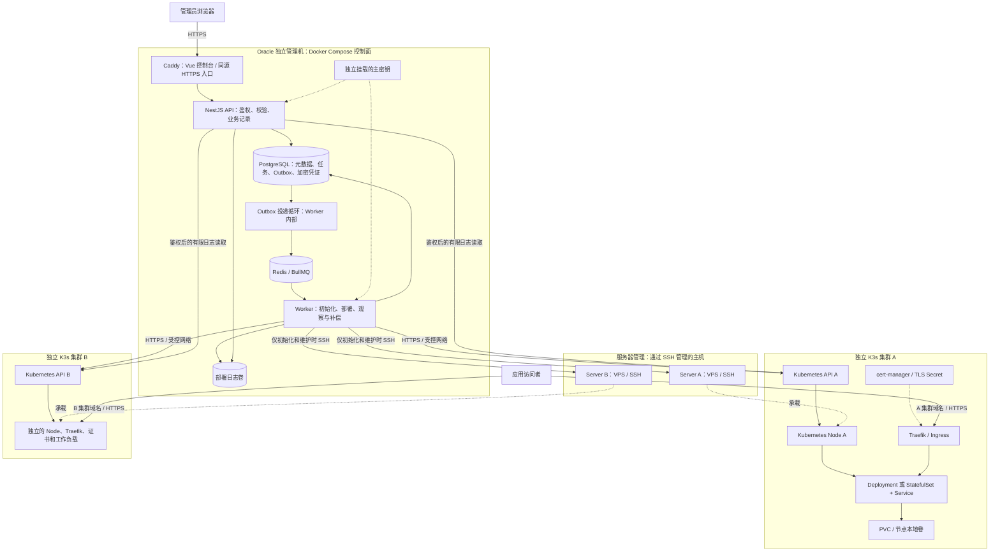
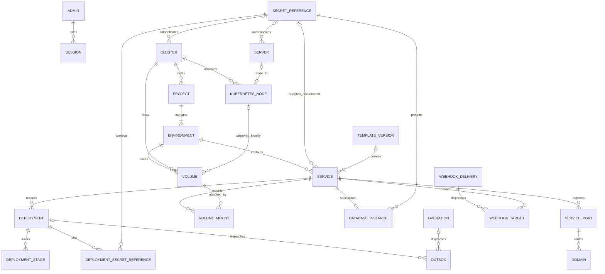

# 个人 PaaS：需求分析与技术方案

版本：1.6。复核日期：2026-10-26（Asia/Shanghai）。状态：与完整 PRD 对齐的技术设计；Stitch、S1–S5 对应本地产品验收及 S5 Linux ARM64 交付已完成。S6 已通过固定 Git 提交到 HTTPS 的真实本地链路及控制台核验，仍在补自动部署、故障与交付验收。真实 VPS、公网入口与目标容量待资源就绪后验证。

当前 `/Users/monkeyozz/Desktop/code/ozz` 已有可运行的控制台、API、Worker、数据库迁移与真实集成测试。原始输入保存在 `docs/prd-original.md`，当前 `docs/prd.md` 是完整需求基线。项目使用 pnpm 12.14.0 管理的 Node 24.22.1；本机全局 Node 22.21.1 保持不变。本地 PostgreSQL 17.11、Redis 7.4.9 已在 Linux ARM64 Docker 环境验证。S2 使用 `ssh2` 1.17.0 与官方 `@kubernetes/client-node` 2.0.1，已通过产品导入两个已有集群并从干净 Linux 初始化第三个集群；具体证据和限制见 [S1 验收](acceptance/S1.md)、[S2 验收](acceptance/S2.md)与 [S2 API 契约](api-contract-s2.md)。

本方案依据[完整 PRD](prd.md)，负责架构、Module、数据与 API 实现约束；任务与阶段以[完整开发计划](development-plan.md)为准。用户已在设计交付后授权实施，并选择先本地测试，真实 VPS 后续接入。设计演示、已运行的应用和真实云部署分别记录证据。

后端的功能限制、性能风险、候选语言与 AI 演进见[后端选型评估](backend-stack-evaluation.md)。已确认长期维护 TypeScript / Node.js，AI 优先调用模型 API 做部署助手、日志诊断和知识库问答，因此继续推荐 Node/NestJS 主栈；Fastify 适配器、数据访问及队列的具体组合按早期验证收敛，不把方向确认当作已完成容量验证。

[Zeabur 功能对照](zeabur-gap-analysis.md)中的 R01–R12 已吸收至完整 PRD 的 F01–F50 / N01–N08，调研记录只作追溯，不再构成另一套待选优先级。

## 1. 需求理解、范围与技术风险

产品的核心是：单管理员在一个控制台中管理多台 VPS 和多个独立 K3s 集群，以项目组织应用和数据库，并通过异步任务发布、观察真实运行状态。每个 Project 创建时绑定且只绑定一个已登记 Cluster，同一 Cluster 可以承载多个 Project；Environment 继承项目目标，Service 归属 Environment 并由此归属 Project。Server 只表示 SSH 主机，不是与 Cluster 并列的另一种调度目标。控制面暂时停止时，已有工作负载应继续运行。

已确认的基础设施边界：Oracle 实例尚未创建，将只运行控制面，应用运行在其他 VPS。建议控制面先选 2 核 / 12 GB / 80 GB；具体实例型号、架构、系统和实际免费权益在建机时核对，容量说明见 3.6 节。

交付范围与完整 PRD 保持一致：

| 范围               | 包含内容                                                | 完成标准                           |
| ------------------ | ------------------------------------------------------- | ---------------------------------- |
| S1 基础工程        | 身份、控制台、数据库、基础 CRUD、凭证与队列验证         | 可以启动开发环境并管理真实持久数据 |
| S1–S4 核心镜像闭环 | 真实集群、镜像、状态/日志、默认域名/HTTPS               | 从控制台发布并通过真实 HTTPS 访问  |
| P0 完整 MVP        | F01–F25，包含持久化数据库、GitHub/Dockerfile 和手工恢复 | S1–S6 加 G-MVP 全部验收            |
| P1 完整个人版      | F26–F42，包含开发体验、备份/观测/网络/节点运维及 CLI    | S7–S8 完成并通过 S9，P0 持续通过   |
| P2 可选扩展        | F43–F50                                                 | 按单项依赖与退出条件单独迭代       |

原始稿的 Git、数据库及模板优先级冲突已在完整 PRD 中消除。本文件不另设一份排期或任务清单；阶段任务、工作量、环境和故障矩阵见开发计划。

S5 的 Node.js/静态模板使用经验证的示例镜像，S6 完成用户源码 Dockerfile 构建，S7 增加有限范围免 Dockerfile 构建。S2 须真实初始化一次并导入已有集群一次，验证两个独立上下文；本地三套 Linux/K3s 已覆盖这两条产品路径，真实 VPS 初始化和网络仍需另验。正式保存数据前完成手工备份与新目标恢复，S8 再实现定时/平台化运维。

主要风险与处理方式：

| 风险                                  | 设计决策                                                                                |
| ------------------------------------- | --------------------------------------------------------------------------------------- |
| 将 VPS、集群和 Node 混为一个对象      | 三种实体独立建模；已导入集群中的 Node 可以没有对应 Server                               |
| 跨地域节点网络复杂且延迟高            | 默认每台 VPS 可以独立组成一个集群；不默认跨地域组建共享集群                             |
| 数据库提交成功、Redis 入队失败        | 业务记录和 Outbox 在同一个 PostgreSQL 事务内提交，由 Worker 内的投递循环补发            |
| 队列重复执行、旧任务覆盖新发布        | 稳定任务 ID、固定资源名称、服务级串行操作、版本校验和周期性补偿                         |
| 平台显示成功但 Pod 实际未就绪         | 分开保存期望配置与观察状态；发布成功必须满足真实 rollout 和健康条件                     |
| 一个通配符域名指向多个独立入口        | 每集群使用独立子域后缀，例如 `*.sg.apps.example.com`                                    |
| SSH 误操作、kubeconfig 地址或证书错误 | 先预检和验证主机指纹，已有 K3s 只接入；检查 API 可达地址、CA 和证书 SAN                 |
| 本地卷所在节点丢失或磁盘被写满        | 展示 PV 节点约束、采集时间和备份状态；local-path 申请容量不是硬配额；停止服务保留卷     |
| 数据库被当作可任意扩容的无状态应用    | 使用单实例 StatefulSet 和显式 PVC；普通应用使用 Deployment，共用部署引擎                |
| 凭证泄露或加密密钥丢失                | 单管理员鉴权、认证加密、密钥独立备份；分别检查控制面凭证与 Kubernetes Secret 的静态加密 |
| Git 构建影响管理控制面                | BuildKit 在独立执行环境运行，不挂载控制面 Docker socket，不授予控制面凭证               |

## 2. 推荐技术栈

| 层次               | 选择                                                                     | 理由与约束                                                                                   |
| ------------------ | ------------------------------------------------------------------------ | -------------------------------------------------------------------------------------------- |
| 工程               | TypeScript、Node.js 24 LTS、pnpm workspace                               | 前后端统一语言；项目内固定工具链，不要求先修改本机全局 Node                                  |
| 前端               | Vue 3、Vite、Vue Router、Pinia、TanStack Vue Query                       | Pinia 管 UI/会话呈现，Vue Query 管服务端资源查询缓存；状态来源仍为后端                       |
| UI 与样式          | shadcn-vue、Reka UI、Tailwind CSS 4、Lucide Vue                          | 按需引入可维护源码，通过统一 tokens 和业务组件实现控制台体验                                 |
| API                | NestJS、class-validator、OpenAPI、Pino                                   | 统一鉴权、校验、错误映射和结构化日志                                                         |
| 数据               | PostgreSQL 17、Prisma                                                    | 外键、事务、迁移和任务持久化；不另建 SQLite 开发模式                                         |
| 异步任务           | Redis 7.4、BullMQ、独立 NestJS Worker 进程                               | 与 API 分开运行；Redis 作为队列基础设施，持久任务记录保留在 PostgreSQL                       |
| Kubernetes         | K3s、官方 `@kubernetes/client-node`                                      | 直接调用 Kubernetes API；减少依赖交互式 kubectl 和 SSH                                       |
| 服务器初始化       | `ssh2`、受版本管理的初始化脚本                                           | SSH 只用于预检、安装、取回初始凭证及明确的维护操作                                           |
| 控制面入口         | Caddy 2、同源控制台与 `/api`                                             | Compose 中提供静态文件、反向代理和管理域名 HTTPS，持久化证书数据                             |
| 网络和证书         | K3s Traefik、标准 Ingress、cert-manager                                  | 先使用单域名证书和 HTTP-01；应用流量直接进入目标集群                                         |
| 存储               | K3s local-path-provisioner                                               | 满足个人单节点集群起步需求，明确本地数据约束                                                 |
| Git 构建（阶段 6） | GitHub 优先、隔离的 BuildKit、OCI Registry                               | 先完成一种 Git 提供方；模板和 Git 最终都进入同一部署引擎                                     |
| 验证               | 类型检查、ESLint、构建、关键 API/持久化集成测试、Playwright 与浏览器验收 | 验证鉴权、凭证、事务、队列恢复和实际用户流程；可访问性自动扫描配合键盘/读屏/中文输入人工检查 |

以上是版本基线，不是对“最新版”的声明。实施时核对兼容性与安全补丁，提交准确版本、lockfile，并为部署镜像固定版本或 digest。K3s、Traefik 和 cert-manager 按经过验证的兼容组合固定，升级单独验收。

保留 PRD 推荐的 Vue/NestJS/Prisma/BullMQ 主栈。增加独立 Worker、Outbox 和单管理员鉴权，是为了满足异步、可恢复与安全要求。第一版不引入微服务拆分、服务网格、Prometheus/Loki 全套或多集群调度框架。

### 2.1 前端组件、状态与性能边界

shadcn-vue 提供可引入项目的组件源码和组合方式，Reka UI 提供交互原语，Tailwind 负责构建样式；源码、复杂表格/表单、业务状态和整体体验由项目维护。这一选择提高定制空间，也增加设计系统与回归工作，不作为性能已达标的依据。

Stitch 已完成全产品页面、关键交互和状态；应用代码按 S1–S9 与 P2 的范围逐步实施。导航主路径为项目列表、创建项目、项目内环境与服务、服务详情。创建项目选择一个 Cluster，项目头部持续显示目标；创建服务先确定项目/环境，集群只读继承。全局服务页提供聚合查询，基础设施页提供服务器/集群管理与关联项目入口；两者不能绕过项目创建独立目标服务。只有已知为单节点且关联 Server 的 Cluster 才可用服务器名辅助显示，实际选项值始终是 Cluster ID。

| 职责        | 实现约束                                                                                                                                                                             |
| ----------- | ------------------------------------------------------------------------------------------------------------------------------------------------------------------------------------ |
| 基础组件    | 放在 Console 的 `components/ui`，记录组件来源与引入版本；升级审查上游差异，不能重新生成后覆盖本地定制。保留正确的 ARIA、键盘和焦点行为                                               |
| 业务组合    | `components/console` 承载资源表格、状态标记、任务时间线、配置编辑和日志；主题与交互规则集中，业务页面不分别复制一套组件样式                                                          |
| 样式/主题   | Tailwind CSS 4 使用对应 Vite 插件和 CSS 主题变量，统一 tokens；检查 Dialog/Popover 的挂载位置及主题继承。状态到 class 使用可扫描的完整映射；将来抽出 workspace UI 包时显式配置扫描源 |
| 资源查询    | TanStack Vue Query 使用包含项目/环境/集群/资源 ID 的 query key；按请求上下文隔离缓存，取消或忽略迟到请求。只在服务端确认后更新真实部署状态；登出/换身份清理缓存，不持久化秘密        |
| 本地状态    | Pinia 保存主题、导航与必要的会话呈现；表单草稿由表单层维护，不把服务端资源复制成另一套事实源。后台刷新不覆盖未保存编辑；revision 冲突提示重新核对                                    |
| 表格/表单   | 采用配套版本的 TanStack Vue Table、VeeValidate＋Zod 进行组合；服务端负责需要跨页的筛选/排序，条件变化重置 cursor。不能直接照搬 React 示例，表单规则与 API 错误须正确映射             |
| 日志/大列表 | 优先服务端分页；日志使用有字节/行数上限的缓冲、批量追加和可见区域渲染，按需采用 TanStack Vue Virtual。稳定 key、滚动锚点、长行与辅助技术行为要实际验证                               |
| 专业模块    | S7 的配置编辑器/终端、S8 的图表按路由或面板懒加载；不为首屏预装和执行全部模块。真实网络请求显示 pending，只有可回退的元数据修改才考虑乐观更新                                        |

S1 固定 shadcn-vue 的稳定来源、Reka UI、Tailwind、Table/Form 及其配套依赖组合并提交 lockfile；不将开发分支示例当稳定版本，也不逐项安装互不匹配的 latest。验证 Tailwind 4 的浏览器要求、Vite 集成、生产样式扫描与弹层主题，避免混用 Tailwind 3 配置和旧 Radix Vue API。

前端采用静态产物由 Caddy 托管；Tailwind 编译发生在构建期，UI 交互主要消耗浏览器资源。频繁查询与日志传输仍影响控制面，须做按资源去重、有限刷新、离开页面清理订阅及隐藏页降频；恢复可见时标记陈旧数据并刷新。UI 选型本身不要求扩大 Oracle 规格，实际包体、浏览器性能和服务端负载分别按 PRD 第 8/11 章测量。

### 2.2 AI 接入方向

F45 按 PRD 第 7.1 节依次交付部署助手、日志诊断与基础知识库。使用 TypeScript 实现提供方 Adapter、AiRun 持久步骤、流式输出、受控工具与检索 Module；模型生成和 embedding 通过外部 API 完成。知识库优先验证 PostgreSQL＋pgvector，必要查询使用参数化 SQL，保留来源/文档/向量模型版本。

API 进程负责鉴权与有界流式返回；较长编排、文档分块及批量 embedding 交给受限 Worker，避免与部署任务争满执行能力。普通管理 API 的查询缓存、任务幂等和秘密管理继续复用；提供方专属对象保留在 AI Module 内。具体模型、能力与用量上限在 F45 前核对，相关表和依赖随迭代创建。

## 3. 控制面、运行面与服务器管理



DNS 负责将相应域名解析到 A/B 的入口地址，不承载代理流量。应用流量不经过 NestJS 控制面。控制面不可用不触发缩容、卸载 K3s 或删除工作负载；证书续期由集群内 cert-manager 继续处理。

控制台使用独立管理域名，例如 `console.example.com`，其 DNS 指向管理机。Compose 内由 Caddy 托管控制台并代理 `/api`，管理域名证书由 Caddy 维护；各应用集群的证书由 cert-manager 维护。管理机上的 PostgreSQL、Redis、API 内部端口只在受控网络使用。第一阶段本地开发可使用 loopback HTTP 和 Vite 代理，公网部署必须使用 HTTPS。

### 3.1 Module 组织与职责

采用领域 Module，小型 Interface 隐藏资源生成、轮询、错误分类等 Implementation。Kubernetes、SSH、凭证读取处设置可验证的 Seam，由真实 Adapter 和测试 Adapter 支持；不为每个 Kubernetes 对象建立一层仅转发调用的包装。

| Module                       | 对调用方提供的能力                      | 内部承担的复杂性                                                                       |
| ---------------------------- | --------------------------------------- | -------------------------------------------------------------------------------------- |
| Identity                     | 登录、登出、当前管理员                  | 密码哈希、会话、登录限速、CSRF                                                         |
| Projects                     | 管理项目、环境及项目部署目标            | 创建时绑定一个已登记 Cluster、默认环境创建、名称约束与继承归属校验；普通编辑不改变目标 |
| Infrastructure               | 注册服务器/集群、请求检查、查看观察结果 | SSH 预检、初始化任务、凭证更新、Node 匹配、超时                                        |
| Deployments                  | 请求发布、取消发布、查询阶段与日志      | 配置快照、队列、幂等、资源应用、健康等待、补偿                                         |
| Networking                   | 分配域名、查询 DNS/路由/证书结果        | 唯一性、Ingress、证书及失败诊断                                                        |
| Storage and Templates        | 创建卷、从模板创建服务                  | 挂载约束、数据库参数和凭证、统一部署输入                                               |
| Git and Builds               | 接收来源变更、请求固定来源构建          | 验签去重、暂停服务规则、远端构建、产物身份与凭证隔离                                   |
| Observability and Operations | 查询历史、执行维护、管理备份与通知      | 采集 Adapter、资源保留、依赖/风险预览、执行状态及失败恢复                              |

API 与 Worker 复用同一份业务规则；API 进程不执行长时间 SSH、构建或 rollout 等待。模板只产生经过验证的服务配置，不独立实现第二套发布流程。

### 3.2 异步任务、一致性和发布状态

1. API 校验配置和关联资源，处理 `Idempotency-Key`，在一个事务内写入 Deployment/Operation、不可变执行目标与 Outbox。服务目标从 Environment→Project→Cluster 推导，不接受独立的服务目标覆盖。
2. 事务成功即返回 `202 Accepted`、任务 ID 和查询地址；队列暂不可用时任务保持 `queued`，不能丢失或冒充执行成功。
3. Worker 内投递循环读取待投递 Outbox，以稳定 ID 加入 BullMQ；拿到确认后标记已投递。中途崩溃允许重复投递，由幂等机制收敛。
4. Worker 执行任务并记录阶段、开始/结束时间、尝试次数、错误码和日志索引。Deployment/Operation 才是任务的持久记录，不能依赖 Redis Job 的保存时间。
5. Worker 周期检查无执行租约的 queued/运行中记录。Redis 重启或任务丢失后，根据数据库状态和 Kubernetes 已发生的变化恢复或明确失败。

API 不同步等待 Redis 连接或投递成功。其 readiness 以 PostgreSQL 和必要配置可用为条件，队列不可用作为降级状态单独报告；Worker 单独报告队列连接和心跳。这样 Redis 故障期间仍可持久接收任务，查询界面明确显示排队原因。

镜像发布：`queued → deploying → waiting_healthy → succeeded`。

Git 发布：`queued → building → deploying → waiting_healthy → succeeded`。

终态为 `succeeded`、`failed`、`cancelled`。非终态可以转入 `failed`；取消先写入 `cancelRequestedAt`，Worker 在阶段边界及长操作中检查，确认停止执行后才转为 `cancelled`。已经变更集群的取消必须记录已发生的副作用，不承诺自动回滚。任务终态不随应用日后故障改写；应用当前健康状态单独同步。

第一版同一服务只允许一个在途变更，重复幂等请求返回已有任务，其他冲突返回 `409` 并附现有任务 ID。部署、重启、停止、恢复和删除遵循同一串行约束。通过数据库约束/租约及配置 revision 校验实现，不能只依赖单进程内存锁。Git 阶段再增加持久化的待处理推送，避免 Webhook 与手动操作竞争。

从阶段 3 起，Deployment 与服务 Operation 在同一事务中竞争 Service 上的共同活动任务槽位，不能各自在不同表中限制并发后就假定互斥。数据库记录负责持久幂等，BullMQ job ID 仅辅助去重。失去租约的旧 Worker 必须停止变更；更新 Kubernetes 对象使用版本条件，重新校验配置 revision，并由同步流程处理未完成的副作用。

每次发布保存不可变配置快照，包含执行时的 projectId、environmentId、clusterId、Namespace，以及镜像输入、端口、命令参数数组、资源、副本和运行期凭证引用。Service 分别保存草稿、最近完整应用的快照、最近成功记录和实际观察；完整应用快照可对应健康失败的 Deployment，不能自动当作旧成功版本。发布前尽量解析镜像 digest 并按 digest 创建资源；实际 Pod `imageID` 也记录在观察结果中。解析失败默认给出可重试错误，不静默以 `latest` 作为可靠版本标识。多架构镜像区分清单 digest 与节点实际镜像 digest。

Operation 同样固定执行对象和适用的 Server/Cluster、项目/环境及 Namespace；纯控制面诊断任务不伪造远端目标。Worker 执行、重试及恢复前核对记录目标、资源归属和当前操作限制，目标失配时明确失败，不能读取当前项目或页面上下文改投另一集群。F48 实现迁移时再验收迁移后旧任务的拦截与对账，不能自动重放，不提前作为 MVP 完成条件；固定的是目标身份，SSH/Kubernetes 等管理认证仍使用该目标当前有效凭证并审计版本。

固定 Namespace 和工作负载名称，写入平台资源标签、Deployment ID 和配置 revision。健康判定检查目标 generation 已被观察、目标 revision 对应 Pod 就绪、副本满足条件以及失败事件，不能把旧版本仍健康当作新版本成功。支持可配置 readiness/startup 探针；未配置应用探针时明确说明就绪判定的能力范围。

阶段 3 将 HTTP/TCP 探测、目标端口、HTTP 路径、启动宽限和超时作为可验收配置。停止保留完整已发布快照及配置副本数；恢复只使用该快照，不带入草稿、最近成功历史或待发布 Git 提交。部分资源应用导致无法确认一致快照时，允许停止，但拒绝重启/恢复，必须先对账或显式完整重发。

S7 镜像回滚以历史成功 digest 替换可信已发布快照的镜像，其余配置与运行期秘密版本保持，产生新 Deployment；不回滚数据库、卷或迁移。已有产物的失败重试复用原 digest，产物缺失明确失败；仅在尚无产物时按原 commit/构建配置或原输入生成，不能悄悄换成最新标签版本。

恢复旧控制面备份与普通进程重启分开处理。恢复后先启用只读对账并暂停旧任务投递；未知平台资源或高于数据库备份的 Kubernetes revision 不能被自动删除、降级或覆盖。差异处理后才恢复可确认安全的写入。

建议初始超时策略：SSH 建连 10 秒、单次 Kubernetes 请求 15 秒、SSH 预检 60 秒、初始化阶段 15 分钟、镜像发布健康等待 5 分钟、构建 15 分钟；均可配置。仅对网络故障、429 和可恢复外部错误进行有上限的指数退避重试，鉴权、配置和主机指纹错误直接失败。人工重试创建关联原记录的新尝试，保留原失败原因。

### 3.3 服务器接入与真实状态

自动初始化首批以 Ubuntu 24.04 LTS 为目标，CPU 架构分别验证。其他系统先提供已有集群接入路径，不承诺通用安装脚本。

初始化流程：保存凭证引用 → 对照可信来源确认 SSH 主机指纹 → 检查 OS/架构/资源/端口/现有 K3s → 安装固定版本或只接入现有安装 → 验证 API 地址、CA/SAN 和权限 → 注册集群与 Node → 同步状态。不得发现现有安装后直接重装，也不自动关闭整机防火墙。

Server 与 Cluster 通过实际 Node 关联。单 VPS 的部署入口对应单节点 Cluster，不能同时登记“服务器目标”和“集群目标”供重复调度；已有登记应在接入验证后更新，不因换入口重新创建目标。多节点集群统一按 Cluster 展示和选择，具体 Pod 所在 Node 由调度与卷约束决定。S1 可将项目绑定到已登记但未验证的 Cluster 完成元数据管理，不能因此显示集群在线；真实发布在 S2 接入验证后，还须通过执行时的目标可用性检查。

K3s kubeconfig 中的 `127.0.0.1` 不能直接用于远程控制面；改变 API 地址还必须确保服务端证书 SAN 正确。6443 优先走私网或仅允许管理机来源；22 同样限制来源。应用入口需要 80/443。8472/VXLAN 不向公网开放，节点间端口按所选 CNI 与 K3s 官方要求配置。

导入 kubeconfig 只接受经过校验的嵌入式 CA、证书/私钥或 Token。拒绝 `exec`、外部认证插件、任意本地文件引用和跳过 TLS 验证的配置，避免导入配置变成控制面代码执行或文件读取入口。

引导安装可能需要管理员权限；常规连接身份按实际功能收敛 RBAC，并记录凭证权限范围和到期时间。阶段 2 必须实现到期提示与替换/更新路径；不能声称导入的 cluster-admin 凭证天然符合最小权限。

凭证或 API 地址更新用于恢复同一已登记 Cluster 的连接，须核对集群身份；连接另一集群应新增登记，不能借编辑连接信息改变已绑定项目的实际部署目标。

控制面 AES-GCM 加密不覆盖 Kubernetes 自身的数据存储。新建 K3s 集群启用并验证 `--secrets-encryption`；导入已有集群分别记录“已启用／未启用／未知”及验证依据。已有集群开启该能力可能需要重启并处理既有 Secret，必须通过明确的维护流程执行，不能在普通接入时静默修改。

期望状态与观察状态分别保存，并记录 `lastObservedAt`、错误和数据是否过期。集群不可达时显示 `unreachable/unknown`，保留最后一次观察时间；不把它解释为应用已停止。建议初期每 15 秒同步活跃发布、每 30 秒同步集群，采用超时、抖动和失败退避。

CPU/内存使用量来自 Metrics API，可调度量来自 Node 状态。metrics-server 不提供完整的磁盘使用率：第一版显示 SSH 预检采集的磁盘信息及时间、Node 的 ephemeral-storage 容量和 DiskPressure。拿不到实时磁盘使用率时显示不可用，不把容量冒充使用量；更完整磁盘采集再增加受控数据来源。

服务当前 CPU/内存按实际 Pod 指标聚合，并展示 requests/limits、OOM/重启和采集时间；指标缺失时显示未知。状态同步按集群批量查询，页面优先读取已保存的观察结果，限制并发并避免对每个 Pod 重复轮询。记录目标 Node 架构，发布前校验镜像是否包含相应平台，不因控制面使用 ARM64 就假定所有应用节点也使用 ARM64。

### 3.4 域名、路由与 HTTPS

平台在数据库保存默认后缀，例如 `apps.example.com`；每个集群拥有稳定的子后缀及期望入口地址：

| DNS 记录                | 指向              |
| ----------------------- | ----------------- |
| `*.sg.apps.example.com` | 新加坡集群入口 IP |
| `*.us.apps.example.com` | 美国集群入口 IP   |

服务域名例如 `web-a7f3.sg.apps.example.com`。生成后持久化，标准化为小写 ASCII/IDNA 并建立全局唯一约束；生成碰撞时有限重试。已有域名不能因服务显示名称变化而被静默更换。已有域名时改变集群后缀属于显式迁移操作。

每个 Domain 独立记录：DNS 检查结果与错误、Ingress 路由状态与错误、证书状态/到期时间/错误，以及各自最近检查时间。检查 A/AAAA 与预期入口是否一致；路由已创建不代表证书签发成功。

服务端口使用具名列表，声明容器端口、用途（HTTP 或通用 TCP）和暴露策略；Domain 路由绑定明确的服务端口。首版提供 HTTP 公开入口与数据库所需私有 TCP，公网 TCP 转发作为后续 P1。

首版用 `ingressClassName: traefik` 和 cert-manager 的 HTTP-01，为单个应用域名签发证书，无需 Cloudflare Token。通配符 DNS 与通配符证书是两回事；后者需要 DNS-01。签发前先以 ACME staging 验证流程，再切换生产签发，避免调试触发限流。

80 必须允许 ACME 验证访问；HTTP→HTTPS 跳转配置必须与 challenge 路径兼容。跟踪 Certificate、Order/Challenge 及相关事件，显示申请失败、续期失败、DNS 错配和证书过期。证书异常应保留可定位的原因，不能一直显示笼统的“配置中”。

### 3.5 存储、日志与凭证

本地卷展示 StorageClass、PVC/PV 状态、容量、PV node affinity 对应节点和备份状态。卷属于 Environment，创建目标从其 Project 派生；保留的 Volume.clusterId 记录 PVC 实际位置，由后端写入且不可单独编辑。`WaitForFirstConsumer` 下，绑定前节点可以为空。卷只能挂载到同一环境、同一实际集群的服务；第一版默认一个可写服务，不把 ReadWriteOnce 等同于跨 Pod 的写入互斥保证。

local-path-provisioner 的申请容量不形成实际写入硬配额；界面明确区分“申请容量”“硬配额支持”和“节点可用空间及采集时间”，没有数据时显示未知。普通应用挂载可写本地卷时，首版限制单副本、采用 Recreate，并在平台发布流程中等待旧 Pod 终止后再接受新实例健康；这会带来发布中断。不能承诺这种策略在手动删 Pod、节点失联等所有场景下都提供写入隔离；需要严格单实例语义时使用 StatefulSet，异常节点不自动强制删除 Pod 后另起写入实例。

数据库单实例部署为 StatefulSet，PostgreSQL 使用数据 PVC，Redis 持久化模板启用 AOF 并挂载 PVC。已初始化数据库的密码/主版本保护覆盖普通保存、发布、重试和回滚，不能将修改初始化变量等同数据库内部轮换；只由 F48 的独立维护流程变更。停止应用只改变目标副本数；删除服务保留卷。销毁卷是单独的确认操作，并展示实际 StorageClass/PV 回收策略及数据删除后果。数据库连接信息只返回非敏感地址、端口、库名及凭证引用；密码由 Worker 注入 Kubernetes Secret，不经普通详情 API 回传。

同一项目的所有环境继承同一 Cluster，但不同环境不自动共享服务依赖。数据库模板默认创建 ClusterIP 私有服务；自动注入连接参数只支持同项目、同环境内的明确依赖。跨项目或跨集群访问需要用户另行配置可达端点和认证，平台不自动公开数据库端口。

Namespace 和 ClusterIP 本身不提供严格的跨环境网络访问隔离；S8 通过已验证的 CNI/NetworkPolicy 实施相应策略，未启用时不声称已有严格隔离。通用变量引用、配置文件和多服务模板在 S7 实施：引用绑定稳定 serviceId/输出键，先等待提供方就绪再固定消费方的运行期秘密版本；提供方变化只提示待发布，继续使用统一发布引擎。

F39 的项目配置复制创建绑定明确目标 Cluster 的新 Project，目标可以与源项目相同或不同；导入已存在项目时则继承该项目目标。为复制的环境/服务/卷建立新标识并重映射依赖，重新分配默认域名、处理自定义域名冲突并保留秘密占位；不通过声明文件覆盖项目或服务目标，不复制数据库数据。

F40 的同项目环境配置复制继承原集群，production/staging 等环境在同一项目集群内隔离；依赖须重映射到目标环境，缺失时阻止相应发布，不能继续引用源生产数据库。生产和测试需要不同集群时使用不同 Project。恢复数据先选定目标项目/环境，默认在其继承集群创建新服务/卷，单独恢复不自动完成项目迁移或 DNS 切换。

F48 默认在目标集群创建新 Project，保留源项目以及源到目标的项目/环境/服务/卷迁移映射，另行完成数据恢复、验证、必要停写和 DNS/流量切换。切换后拒绝重放会重新写入源运行面的旧任务，也不将其改投目标集群；其他任务须按固定目标与迁移状态核对后才可继续。不通过普通 PATCH 实现迁移，也不承诺零停机或自动搬盘；数据库密码轮换和主版本升级仍走各自独立维护流程。

部署日志先使用 API/Worker 共享的持久化日志卷，按任务 ID 保存，数据库记录索引。查询采用有上限的条数和不透明游标，不接受任意文件路径。保留期限和清理失败可观测，先不部署 Loki。

Pod 日志通过 Kubernetes API 查询，支持选择 Pod、容器、上一轮容器日志和有限的 `tailLines/sinceTime` 刷新。Kubernetes 原生日志不是持久分页存储；Pod 删除或日志轮转后，旧内容可能无法取回。界面在 Pod/容器切换时标记中断，不伪造连续历史。Git 构建完成前，镜像服务的构建日志应显示“不适用”。

SecretReference 保存类型、密文、随机 nonce、认证 tag、密钥版本和脱敏元数据，使用 AES-256-GCM 等认证加密。运行期凭证的语义更新创建新引用，历史发布固定其版本；SSH/Kubernetes/Git/Registry 等操作认证使用资源当前有效凭证并审计，不随回滚恢复旧管理认证。主密钥轮换通过可验证的重新加密流程进行。主密钥通过受权限保护的文件或 Docker Secret 挂载，缺失时明确拒绝相关功能，不能自动生成新密钥替代旧密钥。

数据库和主密钥分别备份，并在文档中说明同时丢失/缺少其一的恢复后果。前端表单仅在受保护请求中提交新凭证；普通 API、任务载荷、配置快照和结构化日志只出现引用或脱敏信息。禁记敏感请求体、Cookie 和 Authorization。已知凭证值在任务日志中脱敏，但应用自行输出的未知秘密不能保证自动识别，日志访问仍必须鉴权。

单管理员密码使用 Argon2id；会话使用随机不透明 Token、服务端会话记录及 HttpOnly/SameSite Cookie，生产开启 Secure 和 HTTPS。管理写操作校验 Origin/CSRF，登录限速，不开放注册，不把管理员 Token 放进 localStorage。控制面数据库和 Redis 不暴露公网。

Git 阶段验证原始 Webhook 请求体签名，接收事件按 `(provider, deliveryId)` 去重，向匹配服务的投递按 `(webhookDeliveryId, serviceId)` 分别幂等，其中 `webhookDeliveryId` 是接收记录的内部主键，避免同一仓库事件只能部署第一个服务。持久保存接收事件和目标投递状态，记录重复/忽略/失败原因；处理目标仓库和分支必须与服务配置一致。Git、仓库推送和构建凭证按用途隔离，构建日志同样脱敏。stopped 服务的合法推送只持久记录为待发布，不自动构建/部署/恢复；resume 使用暂停前完整已发布快照，所选提交需要明确的新发布动作。

### 3.6 Oracle 控制面规格与容量

用户已明确 Oracle 只运行控制面，应用放在其他 VPS，实例尚未创建。建议起步使用 2 核 / 12 GB / 80 GB；控制面不运行应用数据库、应用 PVC、镜像仓库或源码构建。平台自身的 PostgreSQL/Redis 和任务日志仍在控制面持久保存。

按用户提供的磁盘额度计算：总计 200 GB，已有实例使用 50 GB，新增 80 GB 后剩余 70 GB。创建前核对其他保留卷的实际占用。80 GB 可按系统与镜像约 20–30 GB、控制面数据库约 5–10 GB、任务日志约 5 GB、本机临时备份约 5 GB 规划，并尽量保留至少 20 GB 可用空间；这些是起始预算，实际使用量须测量。

任务日志可从保留 14 天或总量 5 GB 的上限起步，Docker 日志单独轮转。Pod 日志按需从运行面获取，不默认长期汇集。长期备份离开控制面机器保存，覆盖平台 PostgreSQL 和独立保存的主密钥。卷扩容按 OCI 流程执行，扩大后核对文件系统容量；不把缩小卷作为默认回退方式。

Oracle 当前 [Always Free 公开文档](https://docs.oracle.com/en-us/iaas/Content/FreeTier/freetier_topic-Always_Free_Resources.htm)列出 A1 约 2 OCPU / 12 GB，与用户报告的 4 核 / 24 GB 额度不同；实际建机必须核对账户权益和费用预估，不能保证所有 4/24 规格免费。CPU/内存和磁盘分别选择，无需因为可选更大计算规格就占满 150 GB。若最终使用 Ampere A1，控制面镜像及 Node/Prisma/本地二进制依赖按 ARM64 验证。

保持独立控制面的入口设计：Oracle 的 Caddy 管控制台 HTTPS，其他 VPS 的 Traefik/cert-manager 管应用 HTTPS。初始化/发布变更初始全局并发可设为 1，状态观察使用独立的有限并发；构建在独立执行环境中进行。第一阶段记录基础 API 延迟、CPU/RSS 和磁盘增长基线，后续结合实际集群数量调整，不预先承诺容量上限。

## 4. Monorepo 与多仓库

| 维度                 | pnpm Monorepo                          | 多仓库                       |
| -------------------- | -------------------------------------- | ---------------------------- |
| API、UI、Worker 联动 | 一次修改可一起校验和交付               | 需要跨仓库版本协调           |
| 类型与契约           | 统一 OpenAPI 生成客户端，容易同步      | 需发布共享包或单独的契约仓库 |
| 本地运行             | 一套 workspace 命令和 Compose          | 多套启动、依赖与配置流程     |
| 发布独立性           | 仍可分别构建 API、Worker、Console 镜像 | 天然独立，但维护成本更高     |
| 个人维护成本         | 较低                                   | 当前规模下收益有限           |

推荐 pnpm Monorepo。第一版不需要 Nx/Turborepo；workspace 脚本足够。前端和未来 CLI 使用从 OpenAPI 生成的公开客户端，不导入 Prisma 模型、后端环境变量或凭证 Implementation。

## 5. 目录结构设计

下列为拟定结构，不表示这些文件已经创建。先建立第一阶段必需内容，后续模块随阶段添加。

```text
ozz/
├── apps/
│   ├── console/                   # Vue 控制台
│   │   └── src/{views,components/ui,components/console,router,stores,queries,styles,composables}/
│   ├── api/                       # HTTP 入口、鉴权与公开 DTO/OpenAPI
│   │   └── src/{auth,projects,environments,servers,clusters,health}/
│   ├── worker/                    # 无 HTTP 长任务；消费、投递、定时同步
│   │   └── src/{processors,outbox,reconciliation}/
│   └── cli/                       # S8；S1 不建空壳
├── packages/
│   ├── database/                  # Prisma schema、分阶段 migrations
│   ├── control-plane/             # API/Worker 共用的业务规则与任务定义
│   ├── api-client/                # OpenAPI 生成的浏览器安全类型与客户端
│   ├── config/                    # 服务端配置校验；不可导入前端
│   └── infrastructure/            # S2 已实现 SSH/Kubernetes Adapter；受限 transport 与具名观察契约
├── infra/
│   ├── docker/                    # API/Worker 镜像、Console 构建及 Caddy 入口
│   ├── k3s/                       # 阶段 2：预检、安装、接入脚本
│   └── cert-manager/              # 阶段 4：安装和 Issuer 配置
├── templates/                     # 阶段 5：版本化、受校验的内置模板
├── tests/integration/             # 真实测试数据库/队列的关键流程
├── docs/
│   ├── prd.md                     # 完整需求基线
│   ├── prd-original.md            # 原始输入归档
│   ├── development-plan.md        # S1–S9 任务与验收
│   ├── technical-plan.md          # 架构参考
│   └── development.md             # S1：启动与故障排查
├── compose.dev.yaml               # 阶段 1：本地 PostgreSQL/Redis
├── compose.yaml                   # 阶段 1：控制面容器运行配置
├── .env.example                   # 变量说明和占位符，不含真实凭证
├── package.json
└── pnpm-workspace.yaml
```

后续 `services/deployments/domains/volumes/templates/webhooks` 按领域加入 API 与业务 Module。S2 已增加 `packages/infrastructure` 与 `packages/control-plane/src/infrastructure`；各阶段只交付实际实现并验证的能力。已授权的完整 Stitch UI 与交互设计可以提前覆盖全部页面与状态，但不表示相应控制器、数据表或业务能力已实现。

## 6. 数据库 ER 与关键不变量

下图为核心模型；完整需求的实体职责以 PRD 第 9 章为准，P1 扩展随 S7/S8 迁移，不在 S1 提前创建全部表。



关系中的凭证可以在未连接资源上为空。历史发布的运行期凭证引用同时保存于配置快照和 DeploymentSecretReference，后者用外键保护保留；两者必须在同一事务中一致写入，管理认证不从旧快照恢复。ER 省略部分审计字段和平台设置等独立实体。

| 实体                                                        | 主要字段/职责                                                                                                                                   | 首次落地                                    |
| ----------------------------------------------------------- | ----------------------------------------------------------------------------------------------------------------------------------------------- | ------------------------------------------- |
| Admin / Session                                             | 唯一管理员、passwordHash；会话 Token 哈希、到期和撤销时间                                                                                       | 阶段 1                                      |
| Project                                                     | id、name、slug、description、必填 clusterId、createdAt/updatedAt；一个项目绑定一个已登记 Cluster，普通编辑不改目标                              | 阶段 1                                      |
| Environment                                                 | id、projectId、name、slug；创建项目时自动建 production，目标继承 Project                                                                        | 阶段 1                                      |
| Server                                                      | id、name、host、sshPort、sshUser、credentialRefId、标签                                                                                         | 阶段 1；预检与主机指纹字段在阶段 2 完善     |
| Cluster                                                     | id、name、slug、apiEndpoint、credentialRefId、连接观察状态                                                                                      | 阶段 1；接入、入口地址和同步字段按阶段增加  |
| SecretReference                                             | id、kind、encryptedPayload、nonce/tag、keyVersion、脱敏元数据                                                                                   | 阶段 1                                      |
| Operation / Outbox                                          | 可观察操作记录及不可变执行目标（按操作类型记录 Server/Cluster 与项目/环境/Namespace）；事务内待投递事件、租约和重试信息                         | 阶段 1，先验证无服务器副作用的诊断任务      |
| KubernetesNode                                              | id、clusterId、k8sUid、name、可选 serverId、容量/状态/观察时间                                                                                  | 阶段 2                                      |
| Service / ServicePort                                       | environmentId，Project/Cluster 由关系推导；类型、具名端口、草稿 revision、完整已发布快照引用、最近成功记录、运行意图/配置副本数及实际观察       | 阶段 3                                      |
| Deployment / DeploymentStage                                | serviceId、revision、不可变配置及执行目标快照（projectId/environmentId/clusterId/Namespace）、digest、状态、阶段时间、错误、日志索引、retryOfId | 阶段 3                                      |
| DeploymentSecretReference                                   | deploymentId、secretRefId；唯一关联及限制删除的外键，保护历史发布凭证                                                                           | 阶段 3                                      |
| Domain / PlatformSettings                                   | servicePortId（推导服务/集群）、hostname、DNS/路由/证书状态；持久化默认后缀                                                                     | 阶段 4                                      |
| Volume / VolumeMount                                        | environmentId、由项目目标产生且不可单独编辑的实际 clusterId/Namespace、PVC/PV、StorageClass、容量和节点；serviceId、mountPath、readOnly         | 阶段 5                                      |
| DatabaseInstance                                            | 唯一 serviceId、engine/version、非敏感连接配置、credentialRefId                                                                                 | 阶段 5                                      |
| Template / TemplateVersion                                  | key、固定 version、参数 schema、生成配置；五类内置模板不存真实密码                                                                              | S5 内置固定版本；S7 仓库/版本管理与组合模板 |
| WebhookDelivery / WebhookTarget                             | 提供方、deliveryId、仓库/commit、接收状态；内部 webhookDeliveryId、目标 serviceId、待发布及投递状态                                             | 阶段 6                                      |
| VariableBinding / ConfigFileVersion / TemplateInstantiation | 稳定引用、内容/秘密版本、模板资源依赖及局部执行结果                                                                                             | S7                                          |
| Backup / BackupSchedule / Alert / AlertDelivery             | 标准备份产物/校验/保留、计划、规则/冷却及实际通知结果                                                                                           | S8                                          |
| ApiToken / TerminalSession / NodeMaintenance                | Token 哈希/撤销、容器会话、节点维护的影响与操作记录                                                                                             | S7/S8                                       |

需要由数据库约束与业务事务共同保证的不变量：

1. `Project.slug`、`Cluster.slug` 唯一；`Environment(projectId, slug)` 唯一；`Service(environmentId, slug)` 唯一。`Project.clusterId` 是指向已登记 Cluster 的非空外键，不设独占该集群的唯一约束；一个 Cluster 可以承载多个 Project。默认 production 环境随项目在同一事务创建，slug 固定且不能单独删除，显示名称可编辑；删除空项目时可一并删除其空环境。
2. Environment 通过 `projectId` 继承项目目标，不独立选择集群；Service 只直接持有 `environmentId`，Project 和 Cluster 通过 Environment→Project 推导，避免保存互相矛盾的归属字段。查询接口可返回只读的推导项目/集群 ID，创建服务不接受独立集群目标。
3. Server 是稳定的 SSH 管理对象，不以 IP 作主键。Cluster 是唯一部署目标，表示一套 Kubernetes API；Node 由 API 观察。Node 可不关联 Server；第一版同一 Server 最多关联一个当前 Node。使用 `(clusterId, k8sUid)` 标识 Node，不能全局按节点名去重。单节点 Cluster 可借助已关联服务器名称呈现，不能再建立可重复调度的 Server 目标。
4. Namespace 使用稳定环境 ID 派生，每个 Environment 仅在所属 Project 的 Cluster 内有一份 Namespace。服务、卷和域名路由使用该继承目标，不隐式取“默认集群”，不在同一环境下另选集群。
5. `Project.clusterId` 创建时确定，普通 PATCH 不允许变更；Environment 不能通过普通编辑改挂其他项目。Service 一旦创建远端资源，`environmentId` 不允许普通 PATCH，即使当前已经停止也一样；Volume 创建 PVC 后同样禁止原地改归属。跨环境复制创建新服务，跨集群配置复制和 F48 迁移创建目标项目/资源并保留必要映射，不通过修改原项目或服务的目标字段搬迁。
6. Domain hostname 全局唯一；默认域名分配必须落库。删除/更名服务与 DNS、路由、证书的清理分开跟踪。
7. VolumeMount 的 service 与 volume 必须具有相同 environmentId，且卷实际 clusterId 等于服务从项目继承的 Cluster，`(serviceId, mountPath)` 唯一。卷所在节点来自该集群中的实际 PV 观察，不能用服务期望节点伪造。销毁卷同时检查期望配置与实际 Pod 挂载；卸载运行中服务的卷须先成功发布新配置。
8. DatabaseInstance 对 Service 为一对零或一，数据库凭证只用受类型约束的 SecretReference。普通应用和数据库服务共用部署记录体系。
9. 同一请求作用域内的幂等键唯一，并保存请求摘要：同键同请求返回原任务，同键不同请求返回 `409`。Outbox 对应 Deployment 或 Operation 之一，不能无归属或同时属于两者。
10. 并发约束、外键限制和必要的 CHECK/部分唯一索引在迁移中真实落地；Prisma 不方便表达的部分使用明确的 SQL 迁移，不仅依赖前端限制。
11. 资源删除以显式清理流程推进。项目/环境仍含服务或保留卷、集群仍被任何 Project 或其他资源引用、卷仍挂载时拒绝直接删除；空 Project 也阻止删除其 Cluster。不能通过删除 Namespace 间接销毁保留 PVC，也不能用数据库级联删除代替远端资源清理。凭证删除须检查当前资源与历史 DeploymentSecretReference，受引用时返回 `409`。

第一阶段仅允许安全的元数据删除：空项目及其空环境可事务删除并释放项目的集群引用，不删除 Cluster/Server/Node；被引用的服务器/集群/凭证返回 `409`。移除登记信息不会 SSH 卸载软件或停止远端应用。S1 可以选择已登记但未验证的 Cluster 创建项目；不存在的 clusterId 必须拒绝，没有登记目标时先登记 Cluster 元数据，真实初始化/导入验证仍在 S2 完成。

## 7. API 模块与规范

统一前缀 `/api`；登录无需已有会话但受限速/Origin 校验，最小健康检查可匿名，Webhook 独立验签，其余管理接口默认鉴权。健康检查只提供最少的依赖信息，避免暴露连接串。OpenAPI 是公开契约源，前端和后续 CLI 由它生成客户端。

| 模块                 | 代表性端点                                                                                                                                                            | 首次落地                                                                                     |
| -------------------- | --------------------------------------------------------------------------------------------------------------------------------------------------------------------- | -------------------------------------------------------------------------------------------- |
| Auth                 | `POST /auth/login`、`POST /auth/logout`、`GET /auth/me`                                                                                                               | 阶段 1                                                                                       |
| Projects             | `GET/POST /projects`、`GET/PATCH/DELETE /projects/:id`；创建必填 clusterId，列表可按 clusterId 筛选，普通编辑不可改目标                                               | 阶段 1                                                                                       |
| Environments         | `GET/POST /environments`、`PATCH/DELETE /environments/:id`，创建必填 projectId 并继承项目目标，列表按 projectId 筛选                                                  | 阶段 1                                                                                       |
| Servers              | `GET/POST /servers`、`GET/PATCH/DELETE /servers/:id`                                                                                                                  | 阶段 1                                                                                       |
| Clusters             | `GET/POST /clusters`、`GET/PATCH/DELETE /clusters/:id`                                                                                                                | 阶段 1                                                                                       |
| Secrets              | `POST /secrets`、`GET /secrets/:id`（仅元数据）、`DELETE /secrets/:id`                                                                                                | 阶段 1                                                                                       |
| Operations           | `GET /operations/:id`、`GET /operations/:id/logs`                                                                                                                     | 阶段 1 起；有任务时提供                                                                      |
| Health               | `GET /health/live`、`GET /health/ready`                                                                                                                               | 阶段 1                                                                                       |
| Server operations    | `POST /servers/:id/discover-host-key`、`/trust-host-key`、`/preflight`、`/initialize`，`GET /servers/:id/nodes`                                                       | 阶段 2；发现/预检/初始化返回 Operation，信任返回更新记录，详见 [S2 契约](api-contract-s2.md) |
| Cluster observation  | `POST /clusters/:id/connection-preview`、`/connect`、`/sync`，`GET /clusters/:id/nodes`；工作负载由 Cluster.observation 返回                                          | 阶段 2；预览不联网，连接/同步返回 Operation                                                  |
| Services             | `GET/POST /services`、`GET/PATCH/DELETE /services/:id`；创建必填 environmentId，Project/Cluster 由后端推导                                                            | 阶段 3                                                                                       |
| Deployments          | `POST /services/:id/deployments`、`GET /deployments`、`GET /deployments/:id`                                                                                          | 阶段 3                                                                                       |
| Deployment actions   | `GET /deployments/:id/logs`、`POST /deployments/:id/cancel`、`POST /deployments/:id/retry`                                                                            | 阶段 3；Git/回滚能力后续扩展                                                                 |
| Runtime              | `GET /services/:id/pods`、`GET /services/:id/logs`、`GET /services/:id/metrics`；`POST /services/:id/restart`、`POST /services/:id/stop`、`POST /services/:id/resume` | 阶段 3，变更返回 Operation                                                                   |
| Domains              | `GET/POST /domains`、`GET/DELETE /domains/:id`、`POST /domains/:id/checks`                                                                                            | 阶段 4                                                                                       |
| Settings             | `GET/PATCH /settings`，含默认应用域名后缀                                                                                                                             | 阶段 4                                                                                       |
| Volumes              | `GET/POST /volumes`、`GET/DELETE /volumes/:id`；`POST /services/:id/volume-mounts`、`DELETE /services/:id/volume-mounts/:mountId`                                     | 阶段 5                                                                                       |
| Templates            | `GET /templates`、`GET /templates/:id`；通过 `POST /services` 的 templateId/参数创建                                                                                  | 阶段 5                                                                                       |
| Database information | `GET /services/:id/database`，仅非敏感连接信息和凭证引用                                                                                                              | 阶段 5                                                                                       |
| Webhooks             | `POST /webhooks/github`，验签和事件去重；管理配置仍需管理员鉴权                                                                                                       | 阶段 6                                                                                       |
| P1 接口              | 变量引用、配置文件、组合模板、回滚、exec/终端、备份/计划、通知、Token、节点维护和配置导入导出                                                                         | 按 F26–F42 及 S7/S8 任务扩展                                                                 |

创建服务、卷及发布操作时，项目/环境上下文必须匹配；传入独立集群目标不能覆盖项目绑定，API 校验与 UI 限制使用同一规则。CLI 的服务操作同样继承项目目标，集群参数可用于基础设施查询和列表筛选，不作为服务执行目标的覆盖项。Stitch 中的全局创建入口也先选择项目/环境，再展示只读目标。

列表统一使用 `limit` 与不透明 `cursor`，默认 20、上限 100，按稳定 `(createdAt, id)` 排序；支持项目、环境、集群和状态等明确筛选项。响应示例：

```json
{
  "data": [],
  "page": { "nextCursor": null, "hasMore": false }
}
```

单资源成功使用 `{ "data": { ... } }`。创建资源返回 `201`，接受异步任务返回 `202`，同步元数据删除返回 `204`。异步响应例如：

```json
{
  "data": {
    "id": "deployment_id",
    "status": "queued",
    "pollUrl": "/api/deployments/deployment_id"
  }
}
```

错误采用 `application/problem+json`（RFC 9457），统一保留 `code` 与 `requestId` 扩展字段，示例中的值均为占位：

```json
{
  "type": "urn:ozz:problem:resource-in-use",
  "title": "资源仍被使用",
  "status": 409,
  "detail": "该集群仍有关联服务，请先处理服务。",
  "instance": "/api/clusters/cluster_id",
  "code": "RESOURCE_IN_USE",
  "requestId": "request_id"
}
```

状态码约定：格式错误 `400`；未登录 `401`；权限/CSRF 拒绝 `403`；资源不存在 `404`；状态、唯一性及幂等冲突 `409`；业务字段校验 `422`；限速 `429`；外部依赖错误 `502/503`；意外错误 `500`。具体内部堆栈只留在脱敏服务端日志。

已返回 `202` 的任务如果后续失败，查询仍返回 `200` 与持久任务 `status=failed`、可定位错误，不能把异步失败变成历史 HTTP 请求失败。健康与查询 API 使用有上限的读取时间；Kubernetes 不可达时明确返回过期观察信息或依赖错误。

长操作支持幂等键。PATCH 使用配置 revision/条件更新避免覆盖并发编辑。启动命令和参数使用数组和校验后的资源字段，禁止将用户输入拼接成任意 SSH shell 命令。

服务 PATCH 保存期望配置并标记“有未发布变更”，随后创建 Deployment 才应用到集群；卷挂载变更同样进入配置 revision。涉及远端资源的创建、删除、重启或停止返回 `202` 及相应任务，查询任务确认完成。`retry` 仅接受 `failed/cancelled` 的原发布并创建新的关联记录；重复取消请求幂等，已结束任务保持原终态。

## 8. 实施与验证的唯一计划

实施顺序、任务 ID、前置依赖、产物、验收和人日统一维护在[完整开发计划](development-plan.md)。本文件不再复制另一套 T1–T9 清单。S1 只建立工程、身份/凭证、基础元数据、无副作用任务、控制台及必要检查；真实 SSH/K3s/部署按后续阶段交付。

测试跨领域 Module 的 Interface，SSH/Kubernetes/构建/存储等外部 Seam 使用真实 Adapter 与受控故障替身；不为每个纯转发包装建立一套镜像实现的测试。模拟故障与真实集群验收分别记录，不以 mock 结果声称接入成功。

G-MVP 覆盖 F01–F25 与适用 N01–N08；S9 覆盖全部 F01–F42。按 PRD 的固定数据量、并发和时间记录性能基线；备份恢复同时验证凭证解密、只读对账和远端状态，不只验证数据库启动。

每阶段交付文件清单、准确命令、测试原始结果、浏览器/集群验收证据和已知限制。`pnpm dev`、迁移、管理员初始化、队列诊断、检查与 Compose 已有可执行实现，使用步骤见[开发说明](development.md)。已完成范围以 [S1](acceptance/S1.md)至 [S6](acceptance/S6.md)的实际记录为准；尚未通过验收的后续阶段仍属于计划。

## 9. 需要提前准备的信息

| 信息               | 建议内容                                                                                                | 何时需要                                    |
| ------------------ | ------------------------------------------------------------------------------------------------------- | ------------------------------------------- |
| 本地开发环境       | 支持项目 Node 的版本管理方式、pnpm、可运行的 Docker Compose                                             | 阶段 1；前期文档阶段仅核对过 CLI 版本       |
| 管理控制面主机     | 已确认计划新建 Oracle 作为独立控制面，建议 2 核 / 12 GB / 80 GB；核对 Shape、架构、系统及免费权益       | 远端部署控制面时；第一阶段仍可先本地开发    |
| Oracle 存储额度    | 用户提供总额 200 GB、已用 50 GB；新增 80 GB 后按该口径剩余 70 GB，建机前核对所有卷实际占用              | 创建实例和后续扩容时                        |
| 管理域名           | 如 `console.example.com`，解析到管理机并允许 HTTPS；Caddy 管理控制台证书，Git 阶段使用同源 Webhook 地址 | 远端部署控制面时；本地开发不需要            |
| 首台应用 VPS       | 已确认应用部署到其他 VPS；准备系统和架构、名称、IP/主机名、地区、SSH 用户/端口、资源和磁盘容量          | 阶段 2；自动初始化首批验证 Ubuntu 24.04 LTS |
| SSH 权限与主机指纹 | 可 sudo 的管理身份或明确的 root 使用方式、可信来源的主机指纹、私钥的安全录入方式                        | 阶段 2                                      |
| 已有 K3s（如有）   | K3s 版本、HTTPS API 地址、CA/认证方式、节点列表、Traefik/存储现状                                       | 阶段 2；有现成集群可先走接入路径            |
| 网络               | 控制面可访问 SSH/Kubernetes API；应用入口 80/443；必要镜像、安装源和 ACME 出站可达                      | 阶段 2–4                                    |
| 默认域名           | 有 DNS 管理权的域名，如 `example.com`；确认使用 `apps.example.com` 及每集群子后缀                       | 阶段 4                                      |
| DNS 与证书         | 各集群入口 IPv4/IPv6、可配置通配符记录的 DNS 服务商、ACME 联系邮箱                                      | 阶段 4；首版不需要 DNS API Token            |
| Git                | 首先支持的提供方（默认 GitHub）、仓库 URL、目标分支、Dockerfile 路径、授权方式和 Webhook 可达地址       | 阶段 6                                      |
| 镜像仓库           | 地址、namespace、私有/公开、构建推送和运行拉取的权限划分；例如 GHCR                                     | 私有镜像阶段 3，Git 构建阶段 6              |
| 数据与备份         | 数据库类型、容量预期、卷所在节点、手动备份位置与数据损失容忍度                                          | 阶段 5                                      |

**第一阶段不依赖真实 VPS、域名、Git Token 或镜像仓库账号。** 可先确定非敏感配置，真实私钥、Token 和密码通过本地受保护配置或后续鉴权表单录入，不写进 Git、PRD 或聊天记录。

## 10. 参考与确认范围

关键设计对应的官方材料；具体部署版本及兼容组合在实施时锁定：

- [shadcn-vue 介绍](https://www.shadcn-vue.com/docs/introduction)与[Vite 接入](https://www.shadcn-vue.com/docs/installation/vite)：组件源码归项目维护，使用对应的 Vue/Vite 与样式配置。
- [Tailwind CSS 兼容要求](https://tailwindcss.com/docs/compatibility)：Tailwind 4 面向现代浏览器，额外采用的新 CSS 能力仍需验证兼容性。
- [K3s Requirements](https://docs.k3s.io/installation/requirements)：API、节点间端口、资源要求及 VXLAN 不应暴露公网。
- [Kubernetes kubeconfig 安全说明](https://kubernetes.io/docs/tasks/access-application-cluster/configure-access-multiple-clusters/)：不可信 kubeconfig 可能造成代码执行或文件暴露。
- [cert-manager HTTP-01](https://cert-manager.io/docs/configuration/acme/http01/)：Ingress solver 与 ingressClassName。
- [Let’s Encrypt Challenge Types](https://letsencrypt.org/docs/challenge-types/)：HTTP-01 的 80 端口要求与通配符证书限制。
- [BullMQ Idempotent Jobs](https://docs.bullmq.io/patterns/idempotent-jobs)：重试任务需要保证幂等。
- [local-path-provisioner 限制](https://github.com/rancher/local-path-provisioner#cons)：申请容量不形成实际写入硬配额。
- [Kubernetes 卷访问模式](https://kubernetes.io/docs/concepts/storage/persistent-volumes/#access-modes)与[Deployment 更新策略](https://kubernetes.io/docs/concepts/workloads/controllers/deployment/#strategy)：RWO 不是写入互斥，Recreate 的保证有具体适用范围。
- [K3s Secret 静态加密](https://docs.k3s.io/security/secrets-encryption)：新建集群启用，以及已有集群所需的维护流程。
- [Caddy Automatic HTTPS](https://caddyserver.com/docs/automatic-https)：独立管理域名的证书和 HTTPS 入口。
- [Oracle Always Free](https://docs.oracle.com/en-us/iaas/Content/FreeTier/freetier_topic-Always_Free_Resources.htm)与[卷扩容](https://docs.oracle.com/en-us/iaas/Content/Block/Tasks/resizingavolume.htm)：公开额度、启动卷/块卷容量及扩大限制；实际权益以账户核对结果为准。
- [Zeabur 功能对照与证据目录](zeabur-gap-analysis.md)：当前 Servers 模式、功能覆盖、PRD 增补建议与官方来源。

已确认 Oracle 作为独立控制面、应用在其他 VPS。完整 PRD 已统一 P0/P1/P2 和业务语义，开发计划覆盖 S1–S9 与可选 P2；用户已授权开始实施，S1 的实际产物、测试与剩余检查见 [S1 验收](acceptance/S1.md)。

原始 PRD 的开工确认条件已由后续实施指令满足，不再重复请求。真实 VPS 尚未准备时，按 [本地测试计划](local-test-and-vps-plan.md)推进；云端网络、安装与容量验证在资源就绪后补齐。
