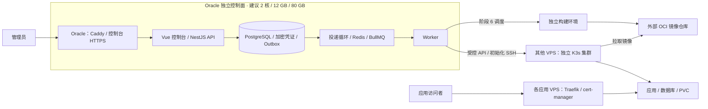

# Zeabur 功能对照与 PRD 增补建议

核对日期：2026-10-25（Asia/Shanghai）。状态：已吸收的调研记录，尚未进入实现。

依据：[原始 PRD](prd-original.md)、[技术方案](technical-plan.md)、用户补充，以及 Zeabur 官方公开文档。原始 PRD 保留原文；“已覆盖”表示原始需求已写明，不表示功能已经开发。

本报告中的 R01–R12 和相关遗漏已整合进[完整 PRD](prd.md)的 F01–F50 / N01–N08，并落实到[开发计划](development-plan.md)。下文的优先级与“建议”保留调研时点的表述，仅作追溯；当前产品范围、优先级和阶段以这两份完整文档为准。

Zeabur 文档源码核对至官方仓库提交 [`479ced09bd232a5f22b3c3c024c71eb8eae0a2e6`](https://github.com/zeabur/zeabur/tree/479ced09bd232a5f22b3c3c024c71eb8eae0a2e6)（2026-10-23），并交叉查阅官网。以下结论是文档对照，没有登录 Zeabur 账号验收各套餐和服务器的实际能力。

## 1. 结论与已确认条件

PRD 已覆盖个人 PaaS 的主体：项目与环境、自带服务器和集群、镜像/Git/Dockerfile 部署、域名与 HTTPS、日志、数据库、卷、模板、CLI。建议保留 Vue/NestJS/Prisma/PostgreSQL/Redis/BullMQ 技术栈。

与 Zeabur 的主要体验差距集中在免 Dockerfile 构建、变量引用、配置文件管理、容器命令执行和多服务模板。健康检查、停止后的恢复、服务资源指标及端口模型需要写成明确的验收要求。自定义域名、回滚、备份、日志搜索、项目复制和 CLI 已在原 PRD 中，不应重新标记为遗漏。

用户已经明确：

- 甲骨文实例尚未创建，只用于运行控制面，应用部署到其他 VPS。
- 首选讨论规格为 2 核 / 12 GB；用户报告可选上限为 4 核 / 24 GB，实际免费权益尚未核验。
- 用户提供的磁盘总免费额度为 200 GB，另一台实例已经使用 50 GB；正在考虑给控制面分配 80 GB，最多分配 150 GB。
- 推荐起步方案为 **2 核 / 12 GB / 80 GB，独立控制面**。具体 Shape、操作系统、CPU 架构、主区域和剩余免费权益在建机时核对。

## 2. 对齐的产品范围

当前 Zeabur 应以 [Servers / 自带服务器][z-server] 为主要参照。[Shared Cluster][z-shared] 官方文档明确已弃用，新项目不能创建，存量共享集群项目自 2026-04-01 起也不接受新服务。

有些文档仍保留旧共享集群和用量计费说明。对照时需要区分服务器模式、套餐功能和历史描述；不把 Zeabur 的商业计费、托管硬件和支持服务纳入个人平台的必备能力。

Zeabur 的[构建规格文档][z-build-spec]说明构建使用独立 CI/CD 基础设施。自托管平台需要自己准备相应构建执行环境；控制面服务器的内存容量不能代替独立构建资源。

## 3. 功能对照

“部分覆盖”包括功能只写了名称、缺少行为约束，或技术方案已补充但尚未明确写入 PRD 验收的情况。

### 3.1 项目与部署体验

| 功能 | Zeabur 官方文档能力 | 原 PRD 覆盖情况 | 建议处理 |
| --- | --- | --- | --- |
| 自带服务器与集群 | 注册自有服务器，管理部署、网络、存储、日志和指标；另有接入已有集群说明 [服务器][z-server] | 已覆盖：4.2 P0；本项目还明确区分 Server/Cluster/Node | 保留多个独立集群设计；不能把接入集群视为自动获得分布式存储 |
| 项目与多环境 | 项目包含多个服务，支持 Production/Staging 和环境切换 [概览][z-overview] | 基础模型已覆盖 P0；环境配置差异为 P1 | 完善变量、域名、卷和部署归属；命名空间隔离与网络隔离分别定义 |
| Docker 镜像 | 镜像、启动命令、环境变量、端口和卷 [镜像部署][z-image] | 已覆盖：4.3、4.6 P0 | 保持阶段 3 主路径，补目标架构校验和镜像 digest 记录 |
| GitHub 与 Dockerfile | GitHub 授权、push 自动部署、Dockerfile 和构建上下文配置 [GitHub][z-git]、[Dockerfile][z-dockerfile] | 已覆盖：4.3 P1，同时属于最终 MVP 验收 | 阶段 6 实现；明确仓库、分支、上下文、文件路径、签名和去重 |
| 免 Dockerfile 构建 | zbpack 自动识别语言/框架/包管理器，生成构建计划 [构建机制][z-build] | 未覆盖；Node.js 模板不等于任意源码自动识别 | P1 增补；Dockerfile 流程稳定后先支持 Node.js/静态网站，评估成熟开源构建器 |
| Monorepo | 根目录、不同 Dockerfile、watch paths 及部分 workspace 支持 [根目录][z-root]、[路径触发][z-watch] | 部分覆盖：已有子目录部署 P1 | 补 buildContext、dockerfilePath、watchPaths 和共享目录变更规则，避免无关服务重复构建 |
| 健康检查与更新 | TCP/HTTP 探测，健康后接流量；挂卷服务使用 Recreate [健康检查][z-health] | 部分覆盖：PRD 提原生健康检查，技术方案已有探针与 rollout | 阶段 3 明确配置和验收；不对有状态发布承诺零停机 |
| 停止与恢复 | 暂停保留配置、域名和卷，可重新启动 [暂停服务][z-suspend] | 部分覆盖：有停止、重启，未明确从停止状态恢复 | 阶段 3 增加明确恢复入口和原副本数保留，避免只 restart 一个零副本工作负载 |
| 部署历史与回滚 | 历史镜像生成新部署；保留当前环境变量，卷/数据库不回滚 [回滚][z-rollback] | 已列 P1，回滚语义需要补清 | 显式定义镜像、配置和数据范围；保留历史记录，重新验证健康 |
| 环境变量 | 批量编辑、变量引用、服务输出、系统变量和优先级 [环境变量][z-vars] | 部分覆盖：基础变量和数据库连接注入已有 | 阶段 3 支持批量录入；阶段 5 补显式服务引用、缺失/循环诊断和秘密类型传播 |
| 配置文件挂载 | 控制台编辑文件内容与路径，启动挂载、更新后重启生效 [配置文件][z-config] | 未覆盖 | P1 高优先；使用 ConfigMap/Secret 和配置 revision，随需要文件的模板交付 |
| 多服务模板 | 同一 YAML 定义多个服务、变量、卷、域名、配置文件和依赖 [模板格式][z-template] | 部分覆盖：当前主要为单服务模板 | 阶段 5 先单服务；随后支持“应用＋数据库”组合、资源预览和部分失败处理 |
| 仓库内配置 | zbpack.json 等构建配置，以及模板 YAML [Node.js][z-node]、[模板格式][z-template] | 部分覆盖：自定义构建配置和模板版本已提及，文件优先级未定义 | 后续设计版本化声明文件及 UI 优先级；不声称官方存在已核实的通用 zeabur.yaml 自动发现规则 |
| 项目复制与导出 | 配置导出不含数据；复制项目文档描述包含卷数据且域名需重绑 [导出][z-export]、[复制][z-copy] | 已有项目复制/导出 P1；跨集群数据迁移语义不足 | 先配置导出/复制；数据复制、目标校验和 DNS 切换作为显式迁移流程，不能通过 PATCH 更换集群 |

### 3.2 网络、数据与运维

| 功能 | Zeabur 官方文档能力 | 原 PRD 覆盖情况 | 建议处理 |
| --- | --- | --- | --- |
| 默认域名、HTTPS、自定义域名 | 自动域名/TLS、自定义域名与路由 [公网网络][z-public] | 默认域名/HTTPS P0；自定义和多域名 P1，均已覆盖 | 保留阶段 4；明确域名绑定的目标端口。Ozz 的默认域名仍需用户拥有 DNS 管理权 |
| 多端口与 HTTP/TCP | 镜像可配置多个 HTTP/TCP 端口及公开入口 [镜像部署][z-image] | 部分覆盖：目前仅泛称容器端口 | 建模为具名端口列表；首版实现公网 HTTP 和私有 TCP，公网 TCP 为 P1；本轮未确认普遍可用的 UDP 暴露能力 |
| 私有网络与服务发现 | 项目内固定服务 hostname、变量引用 [私有网络][z-private] | 私有服务/内网访问已有 P1；数据库连接注入已有 P0 | 把数据库所需 ClusterIP/DNS 纳入阶段 5 前置能力；不承诺跨独立集群自动互通 |
| 卷与持久化 | 服务范围的卷及持久数据；挂卷服务可能中断更新 [卷][z-volumes] | 已覆盖：4.6 P0，技术方案对节点和容量约束更具体 | 保留 local-path 无硬配额、节点约束、单写入服务和删除服务留卷规则 |
| 备份与恢复 | 套餐相关异地/定时备份，数据库 dump 与普通卷备份/恢复 [备份恢复][z-backup] | 已覆盖：4.6 P1 | 补“正式数据库上线前成功恢复一次”的验收；定时任务和平台化恢复仍属 P1 |
| 实时日志与搜索 | stdout/stderr、实时查看、关键词过滤；部分套餐有日志转发/更长保留 [日志][z-logs]、[Pro][z-pro] | 查看日志 P0；搜索、过滤、下载、集中存储 P1，已覆盖 | 控制读取上限和日志保留；无需提前部署 Loki；具体套餐保留时长未核实 |
| 服务指标 | CPU/内存、部分历史和网络用量 [指标][z-metrics]、[用量][z-usage] | 节点指标 P0、历史趋势 P1；服务/Pod 当前值验收不足 | 阶段 3 明确服务/Pod CPU、内存、limit、OOM 和重启次数；网络/磁盘不能冒用 Metrics API 数据 |
| 资源调整与预留 | 服务 CPU/内存配置，服务器系统资源预留 [资源调整][z-scaling]、[服务器运维][z-operate] | 应用 limits/副本 P0；系统资源预留未明确 | 为运行面预留系统资源、执行应用 requests/limits；本次资料不足以确认所有模式通用自动扩缩容 |
| 容器命令执行/终端 | 选定服务执行命令，提供容器 shell [命令执行][z-exec]、[服务器运维][z-operate] | 未覆盖；启动参数不能替代在线执行 | P1 高优先，镜像与日志稳定后增加；先一次性命令，再完整交互终端 |
| 文件管理 | 上传、下载和文本编辑，受镜像工具等条件影响 [文件管理][z-files] | 未覆盖 | 完整文件管理 P2；明确临时文件、PVC 和声明式配置文件的持久性差异 |
| 路由 IP 规则与主机防火墙 | Gateway 有 IP 访问规则；主机防火墙文档明确可用范围有限 [Gateway][z-gateway]、[防火墙][z-firewall] | Ingress 基础已覆盖；完整规则管理未写 | P2；复用 Traefik/受控主机维护流程，不将防火墙视为已普遍可用的对齐前提 |
| 告警与通知 | 已核实项目预算通知；未从本轮材料确认通用节点/证书告警的完整范围 [预算][z-budget] | 节点异常/资源阈值通知 P1、证书失败可观测性 P0，已有 | 保留自身运维告警需求，不复制账单触发自动停服 |

### 3.3 开发工具与可后置能力

| 功能 | Zeabur 官方文档能力 | 原 PRD 覆盖情况 | 建议处理 |
| --- | --- | --- | --- |
| CLI | 登录、上下文/环境切换、部署、日志、重启、非交互使用 [CLI][z-cli] | 核心管理命令已有 P1 | 补机器可读输出和明确目标环境；本地源码上传可后续增加 |
| API Token 与公开接口 | API Key 的创建/撤销，公开 API 及上传接口 [API Key][z-api-key]、[API][z-api] | REST API 已有；自动化 Token 生命周期未明确 | CLI 阶段补可撤销 Token，服务端仅保存哈希；继续使用 REST/OpenAPI，无需为对齐改成 GraphQL |
| AI 部署助手 | 自然语言创建项目、部署、配置变量和域名 [概览][z-overview] | 未覆盖 | P2 候选，建立在可靠 API 和操作记录之后；不影响基础 MVP |
| PR 自动预览环境 | 本轮未找到足够官方证据；多环境/Git 自动部署不能单独证明此能力 | 未覆盖 | 可列 Ozz 自身 P2 候选，不列为已证实的 Zeabur 必须对齐项 |

公开注册、多租户、团队计费、预算停服、服务器售卖、域名购买、完整模板市场运营和企业支持继续不纳入第一版。对象存储、消息队列等应用可逐步作为模板扩展，不为每种软件单独增加发布引擎。

## 4. 建议补入 PRD 的可验收条款

下面是待确认的增补建议。P0 补清进入已有功能所在阶段；P1 增补按依赖安排，不增加第一阶段的远端部署任务。

| 编号 | 建议与阶段 | 验收要求 |
| --- | --- | --- |
| R01 | P0 补清：健康检查，阶段 3 | 可配置 HTTP/TCP 探测、路径、端口、启动宽限和超时；错误路径使新部署失败并保留原因。无状态更新验证健康再接流量；挂卷更新明确中断策略 |
| R02 | P0 补清：停止后恢复，阶段 3 | 记录期望运行状态和配置副本数；停止实际缩到零且保留域名/卷；恢复以当前已发布配置重新启动并验健康，未发布草稿不被静默应用 |
| R03 | P0 补清：具名端口与私有服务，阶段 3–5 | 每个端口声明名称、容器端口、用途和暴露策略；域名绑定明确端口；数据库默认只有 ClusterIP，公网不可直接访问数据库端口 |
| R04 | P0 补清：服务资源与架构诊断，阶段 2–3 | 从实际 Node 记录架构；发布前校验镜像平台；展示服务/Pod CPU、内存、限制、OOM/重启及观察时间；无指标时显示未知 |
| R05 | P1 增补：变量引用，阶段 5；批量录入可在阶段 3 | 应用显式引用同环境、同集群数据库/服务输出；发布前检查缺失和循环引用；秘密属性随引用传播，普通响应保持脱敏；构建期和运行期变量分开 |
| R06 | P1 增补：配置文件，阶段 5 | 可声明容器绝对路径、文件内容/秘密引用和权限；检查重复路径及卷覆盖；通过统一配置 revision 发布；不支持任意宿主机文件编辑 |
| R07 | P1 增补：容器命令执行，阶段 3 稳定后 | 选择服务、Pod 和容器，查看输出与退出码；执行具备鉴权、超时、输出上限、断开处理和脱敏操作记录；主机 Web SSH 单列 P2 |
| R08 | P1 增补：多服务模板，阶段 5 单服务模板之后 | 发布前预览服务/卷/域名和资源用量；按依赖创建，每个服务产生独立部署记录；局部失败可重试，不自动删除已有数据 |
| R09 | P1 补强：Git 构建体验，阶段 6 | 支持构建上下文、Dockerfile 路径和 watch paths；无关路径提交不触发构建，共享依赖变更按规则触发；自动构建先支持 Node.js/静态站点并允许 Dockerfile 覆盖 |
| R10 | P1 补清：回滚，阶段 6 或镜像历史稳定后 | 默认选择历史成功镜像 digest，配合当前已发布配置创建新 Deployment；预览差异并重新验健康；不修改历史、不回滚卷/数据库，完整历史配置恢复另行设计 |
| R11 | P1 补清并增加上线门槛：备份恢复，阶段 5 | 正式存数据前完成一次手动备份，恢复到新数据库服务/新卷并校验；至少一份备份离开数据所在机器。定时、上传下载 UI 和自动恢复仍按 P1 实施 |
| R12 | P1 补强：CLI/API Token，CLI 阶段 | 支持明确 project/environment/service、非交互调用和 JSON 输出；Token 可撤销，撤销后调用被拒绝；CLI 不要求用户持有集群管理员凭证 |

补充约束：

- **环境隔离**：同环境、同集群是自动变量引用的许可范围。Namespace 和 ClusterIP 本身不等于网络访问隔离；严格跨环境隔离需要验证 CNI/NetworkPolicy，并在未启用时如实说明。
- **配置优先级**：后续引入仓库声明文件前，先明确 UI、文件、系统注入值的优先级和配置版本；不同时引入多套相互覆盖且不可追踪的配置源。
- **部署与数据分开回滚**：镜像、环境变量、凭证版本和数据库数据不是同一种版本。恢复数据始终是独立、可观察的操作。
- **模板复用同一引擎**：模板生成经过校验的资源和服务配置；模板、Git、镜像统一进入现有异步发布路径。

## 5. Oracle 独立控制面与 80 GB 磁盘

### 5.1 推荐规格与免费额度核对

建议先建 **2 核 / 12 GB / 80 GB** 的独立控制面。CPU、内存和磁盘可分别规划；即使账户允许 4 核 / 24 GB，也没有必要因此把磁盘直接占满 150 GB。

按用户提供的存储额度计算：`200 GB - 50 GB - 80 GB = 70 GB`。创建前仍需核对所有启动卷、块卷和保留卷的实际占用。70 GB 可以供后续扩容使用，但不足以在保留现有 50 GB 和 80 GB 卷的同时，再创建完整的 80 GB 恢复卷。

本轮读取的 [Oracle Always Free 官方文档][o-free]写明：A1 每月免费 1,500 OCPU 小时和 9,000 GB 小时，约 2 OCPU / 12 GB；这与用户报告的 4 核 / 24 GB 存在差异。公开文档不能替代账户权益核验，也不能把可选规格上限直接当作免费额度。建机时核对 Shape、Always Free 标识、剩余额度及费用预估。该文档同时说明主区域启动卷与块卷合计 200 GB 的免费存储范围。

若选择 Ampere A1，按 `linux/arm64` 验证控制面 Node、Prisma、本地二进制依赖和容器镜像；型号未确定前不直接断言架构。控制面与应用节点可以使用不同架构，应用镜像按目标集群的实际 Node 架构验证。

### 5.2 容量预算与增长控制

80 GB 对只保存控制面数据的起步环境是合理预算，前提是镜像仓库和构建执行环境使用外部资源，Pod 日志按需从远端读取。以下是规划额度，不是实测消耗，也不是可承载服务数量的保证。

| 用途 | 起步规划 |
| --- | --- |
| 系统、更新、控制面镜像和容器层 | 合计预留约 20–30 GB，旧镜像按保留策略清理 |
| PostgreSQL、Redis 持久数据 | 初期预留约 5–10 GB，随实际数据量复核 |
| 部署任务日志 | 例如保留 14 天、总量上限 5 GB，任一上限先到即按策略清理 |
| 本机临时备份 | 约 5 GB 起步限额，按实际备份大小调整；长期备份放其他位置 |
| 可用空间余量 | 尽量保持至少 20 GB，避免更新、日志或数据库临时文件挤满磁盘 |

Docker stdout/stderr 日志单独配置轮转。运行日志的搜索/长期保存按后续需求引入，不默认把全部应用日志长期汇集到控制面。清理失败、磁盘低空间和任务日志被截断必须可观察。

[OCI 卷扩容][o-resize]支持扩大，不支持原地缩小；扩容时需备份并确认系统、分区和文件系统识别新容量。80 GB 起步保留了后续选择空间。

### 5.3 已确认的拓扑

Oracle 的 Caddy 管控制台证书，各应用 VPS 的 Traefik/cert-manager 管应用入口与证书，分别使用各自服务器的 80/443。控制面不承担应用流量，也不保存应用 PVC。

初期可将初始化/发布变更的全局并发设为 1，观察同步使用独立的有限并发；阶段 6 的构建在独立环境中执行，初始并发 1。按集群批量读取状态，限制 Prisma 连接池总量、日志字节数与轮询频率，后续按实测调整。

Oracle 的 NSG、安全列表和系统防火墙需一起检查：控制台开放 HTTPS，SSH 限管理来源，数据库/Redis 不开放公网。运行面 API 的 6443 只允许控制面或受控私网访问。具体云账号操作仍需在用户确认开发和接入后进行。

## 6. 对开发阶段的影响

| 阶段 | 本轮建议增补 |
| --- | --- |
| 1. 基础工程 | 保持原范围；增加控制面资源基线记录、日志轮转/保留配置说明，确认目标架构后验证镜像。不需要先创建 Oracle 实例 |
| 2. 集群管理 | 记录节点架构，核对网络、资源预留和指标可用性 |
| 3. 镜像部署 | 补清健康检查、停止恢复、具名端口和服务当前指标；容器命令执行作为后续 P1 增量 |
| 4. 域名与 HTTPS | 保持默认域名闭环；自定义/多域名仍为 P1，路由明确绑定服务端口 |
| 5. 存储与模板 | 补变量引用、需要的配置文件和手动备份恢复验收；组合模板在单服务模板稳定后加入 |
| 6. Git 与构建 | Dockerfile 先行；完善 Monorepo 触发规则，再增加有限范围的自动构建；明确镜像回滚语义 |
| 后续 | CLI/API Token、配置导出与复制、定时备份、日志高级能力；文件管理、主机 Web SSH、AI 助手和预览环境等 P2 按需要选择 |

不因本次对照一次性生成上述全部模块。根据原 PRD 第十一节，技术方案与增补范围确认后才开始第一阶段。

## 7. 官方资料

下列链接对应上表的官方依据；页面能力说明不替代真实产品验收。几处需要保留的证据边界：

- 日志页描述当前实例日志，较新的 Pro 套餐页又列出日志转发和更长保留；本轮未核实具体时长。
- 私有网络页证明项目内互通，不证明任意独立服务器/集群之间自动互通。
- 导出配置不含数据；项目复制文档另行描述数据复制。自动复制在所有自带服务器上的支持范围尚未实测。
- 防火墙页说明能力可能仍在开发或仅适用于部分服务器；服务用量页的磁盘指标也有未完成标记。
- 构建规格页仍含旧 Shared Cluster 描述；以当前 Servers 文档界定运行面，以构建规格页确认独立构建这一事实。

[z-server]: https://zeabur.com/docs/en-US/server
[z-shared]: https://zeabur.com/docs/en-US/server/shared-cluster
[z-overview]: https://zeabur.com/docs/en-US/get-started/platform-overview
[z-image]: https://zeabur.com/docs/en-US/deploy/methods/custom-docker-image
[z-git]: https://zeabur.com/docs/en-US/deploy/methods/github-integration
[z-dockerfile]: https://zeabur.com/docs/en-US/deploy/methods/dockerfile
[z-build]: https://zeabur.com/docs/en-US/deploy/how-deploys-work
[z-build-spec]: https://zeabur.com/docs/en-US/deploy/config/build-spec
[z-root]: https://zeabur.com/docs/en-US/deploy/config/root-directory
[z-watch]: https://zeabur.com/docs/en-US/deploy/config/watch-paths
[z-health]: https://zeabur.com/docs/en-US/operations/monitoring/health-checks
[z-suspend]: https://zeabur.com/docs/en-US/operations/deployment/suspend-service
[z-rollback]: https://zeabur.com/docs/en-US/operations/deployment/rollbacks
[z-vars]: https://zeabur.com/docs/en-US/deploy/config/environment-variables
[z-config]: https://zeabur.com/docs/en-US/operations/data/config-file-management
[z-template]: https://zeabur.com/docs/en-US/template/template-format
[z-node]: https://zeabur.com/docs/en-US/guides/nodejs
[z-export]: https://zeabur.com/docs/en-US/deploy/manage/export-project
[z-copy]: https://zeabur.com/docs/en-US/deploy/manage/copy-project
[z-public]: https://zeabur.com/docs/en-US/deploy/networking/public-networking
[z-private]: https://zeabur.com/docs/en-US/deploy/networking/private-networking
[z-volumes]: https://zeabur.com/docs/en-US/operations/data/volumes
[z-backup]: https://zeabur.com/docs/en-US/operations/data/backup-restore
[z-logs]: https://zeabur.com/docs/en-US/operations/monitoring/logging
[z-pro]: https://zeabur.com/docs/en-US/pricing/pro-plan
[z-metrics]: https://zeabur.com/docs/en-US/operations/monitoring/metrics
[z-usage]: https://zeabur.com/docs/en-US/operations/resources/service-usage
[z-scaling]: https://zeabur.com/docs/en-US/operations/resources/scaling
[z-operate]: https://zeabur.com/docs/en-US/server/operate
[z-exec]: https://zeabur.com/docs/en-US/deploy/config/command-execution
[z-files]: https://zeabur.com/docs/en-US/operations/data/file-management
[z-gateway]: https://zeabur.com/docs/en-US/deploy/networking/gateway
[z-firewall]: https://zeabur.com/docs/en-US/server/firewall
[z-budget]: https://zeabur.com/docs/en-US/operations/resources/project-budget
[z-cli]: https://zeabur.com/docs/en-US/developer/cli
[z-api-key]: https://zeabur.com/docs/en-US/developer/api-keys
[z-api]: https://zeabur.com/docs/en-US/developer/public-api
[o-free]: https://docs.oracle.com/en-us/iaas/Content/FreeTier/freetier_topic-Always_Free_Resources.htm
[o-resize]: https://docs.oracle.com/en-us/iaas/Content/Block/Tasks/resizingavolume.htm

